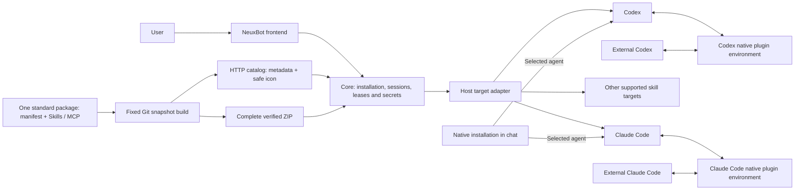
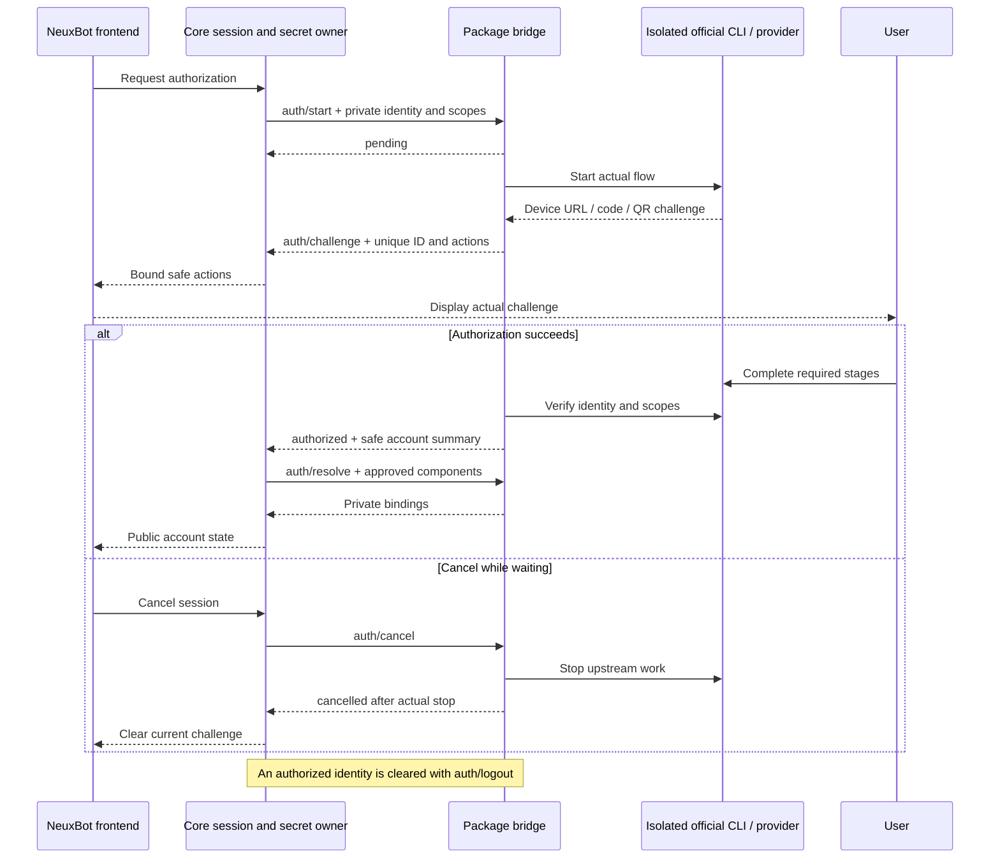

# Neux Plugins

[English](README.md) | [简体中文](README.zh-CN.md)

A library of self-maintained OpenAI/Codex-standard plugins for GitHub code review and collaboration, and Feishu and WeCom documents, tables, calendars and tasks. Each entry is one complete package under `plugins/`.

| Plugin | Capabilities |
| --- | --- |
| [GitHub](plugins/github/README.md) | Search repository code, follow issues and pull requests, inspect changes and check results |
| [Feishu Office](plugins/feishu-office/README.md) | Create and organize documents, manage table records, arrange events and follow up on tasks |
| [WeCom Office](plugins/wecom-office/README.md) | Manage documents and tables, arrange meetings, track tasks and work with email and files |

The root is a library and marketplace, not a single plugin, so it has no root single-plugin `plugin.json`. Each package owns its standard identity and components. The library maintains one definition per capability; host adapters handle target formats instead of collecting separate Codex and Claude implementations.

## Packages and host adapters

- `plugins/github/`: one standard manifest, one official GitHub MCP declaration, business documentation, brand assets and package-owned device authorization.
- `plugins/feishu-office/`: one standard manifest, complete official skills and relative resources, business documentation, brand assets and package-owned authorization.
- `plugins/wecom-office/`: one standard manifest, 15 fixed official skills and their resources, bilingual descriptions and package-owned QR authorization.
- `.agents/plugins/marketplace.json`: local entries pointing at those actual standard packages. There is no parallel Claude marketplace or source-only native reference directory.
- `patches/`: reviewed provider isolation patches, regression sources, original licenses and provenance.
- `scripts/`: deterministic catalog/ZIP builds and independent fixed-source provider builds. Ignored `dist/` contains release artifacts; `.cache/` contains verified build inputs.

NeuxBot installs plugins only from this maintained library’s published HTTP catalog and adapts each standard package to the selected agent. It provides no plugin upload, local-directory import, or ZIP import. Native plugin installation requested in a conversation belongs to the current Codex or Claude Code environment, shared with the same external CLI. Those native installations, enablement settings, and authentication stay under the CLI’s ownership and are not registered or managed as NeuxBot resources. Direct use of the local marketplace or package follows the target CLI’s capabilities; Codex does not interpret NeuxBot-specific authentication declarations automatically.

The manifest's `repository` and `interface.developerName` identify the official capability project and brand: GitHub / `github/github-mcp-server`, and 飞书 / `larksuite/cli`. `author` identifies NeuxBot contributors as authors of the package wrapper and bridge; uniform `provenance.upstream` records the actual business capability author, version, license and repository used by the plugin information panel. Official service/skill authorship is not authorship of this packaging, and brand attribution is not official endorsement. See [third-party notices](THIRD_PARTY_NOTICES.md).



## Maintaining a standard package

Create `plugins/<key>/.codex-plugin/plugin.json` with standard identity, version, description, truthful author and license. Declare actual skills and MCP components using the [official packaging fields](https://developers.openai.com/plugins/build/plugins). Preserve third-party source, scripts, relative references and executable modes. Copy the reviewed upstream content needed by this package and maintain it locally, with actual licenses and modifications recorded in the [uniform provenance contract](docs/PROVENANCE.md). Do not add a second hand-maintained component index or native source-reference manifest.

Each plugin's English and Chinese README describes only its own capabilities, access requirements and practical uses. It contains no host roles, installation flow, chat prompts or language navigation; the host selects the document by system language. Standard English interface fields, optional localized display text and static PNG assets follow the [presentation maintenance guide](docs/MAINTAINING.md). A package without `.neuxally/` remains a standard package.

## Declaration-driven authorization

MCP services and skill components remain declared by their standard files. Optional `.neuxally/integration.json` adds only host integration: authentication strategy, scopes, preferred challenge action and exact authorized component bindings. It does not declare a second identity or component list.

Packages requiring authorization use `authentication.strategy: plugin-command`, `protocol: neuxally-auth/1`, trusted Node and a package-relative bridge entry. The frontend displays safe actions supplied by Core and sends cancellation requests. Optional [challenge notices](docs/AUTH-CHALLENGE-NOTICES.md) are declared by the package, apply only to the current challenge and use the host's fixed warning style. Core owns sessions, leases and private execution bindings. The bridge interprets its vendor flow; raw provider frames, credentials and private bindings do not enter the frontend.

- GitHub uses the official device OAuth flow through a fixed isolated GitHub CLI. It emits the actual `https://github.com/login/device` URL and one-time code, verifies account and granted scopes online, and resolves a private OAuth Bearer header only for the exact `github` MCP at `https://api.githubcopilot.com/mcp/`. Only the declared Codex and Claude targets receive these OAuth bindings, both referring to that same component; other runtimes cannot fall back to an undeclared authorization route. No PAT placeholder or managed app connector is bundled. `preferredAction: open-url` does not imply QR support.
- Feishu uses successive official application-creation and user-authorization QR challenges. An existing application without a user identity is a valid pending stage; only final online identity/scope verification marks it available. `preferredAction: show-qr` allows the frontend to prepare a QR placeholder while waiting for actual challenge actions. See the [Feishu bridge contract](plugins/feishu-office/.neuxally/auth/README.md) and [GitHub bridge contract](plugins/github/.neuxally/auth/README.md).



Provider programs are independent digest-locked dependencies downloaded by each plugin into its private data directory. The host does not bundle or download one vendor program per plugin. Package locks pin HTTPS asset URLs, sizes, hashes, fixed source, toolchain and isolation evidence. GitHub clears inherited CLI credentials and uses a private profile; its patched keyring service is bound to the canonical profile directory digest. Feishu uses its existing private profile and credential isolation. Trusted test overrides can supply the same program boundary without looking up user-global CLIs.


## WeCom Office

`plugins/wecom-office/` packages 15 official skills and their relative resources from the fixed `wecom-cli` 1.3.4 release commit. It pins five official npm platform archives and extracted binary digests, downloads them privately, and uses the official CLI QR flow. It does not install a global npm command or declare a legacy MCP endpoint. The shared skill routes installation and account changes through the managed plugin lifecycle; other upstream skill content is preserved.

The host must support PNG data URLs for `show-qr` challenges and merging verified private CLI paths for multiple plugins. Windows ARM64 has no official platform asset. See the [business overview](plugins/wecom-office/README.md) and [bridge guide](plugins/wecom-office/.neuxally/auth/README.md).

## HTTP catalog and complete snapshots

Details and SKILL text are available before installation or authorization through digest-bound [read-only details sidecars](docs/DETAILS.md), independently of the complete installation ZIP.

Use the [latest catalog](https://github.com/JieWaZi/neux-plugins/releases/latest/download/catalog.json) or [fixed v0.1.0 catalog](https://github.com/JieWaZi/neux-plugins/releases/download/v0.1.0/catalog.json). Each `{schemaVersion:2,entries:[...]}` entry records `key`, full `sourceCommit`, `archiveURL`, `archiveSHA256`, `packagePath: plugins/<key>`, standard `name`, `version`, English `description` and `format: codex`. Optional localized maps and a validated embedded icon support presentation before package download; components are read from the actual package.

A ZIP contains its complete standard package, applicable local Codex index, source/license evidence and public patches. No upstream Git or HTTP materialization is required by installation or ordinary catalog builds. Separate business services and first-use provider dependencies still require network access. Clients verify the selected archive digest before extraction. Installed snapshots remain identified by their source commit and digest when test-release assets change.

## Build and test release

Node 22+ and Git build a committed snapshot; dirty workspace files and timestamps do not enter the result:

```sh
npm ci
npm test
node scripts/build-catalog.mjs HEAD v0.1.0
```

The builder validates canonical packages, the shared provenance schema, dependency locks and local asset hashes, produces deterministic ZIPs and catalog, and replaces its output after validation. The CLI replaces the `dist` output directory while preserving `dist/providers`; use the exported `buildCatalog({root,out,sourceCommit})` with a separate output directory when existing unrelated receipts must be retained.

Provider rebuilds are deliberate independent operations, not a prerequisite for catalog builds:

```sh
node scripts/build-github-provider.mjs
node scripts/build-lark-provider.mjs
```

Each fixed-source provider build verifies source and isolation tests, cross-compiles six platforms and collects actual dependency license texts. Existing provider locks continue to reference their verified `v0.1.0` assets; releasing package metadata and icons does not rebuild those dependencies. Protocol/schema versions and internal package identities have their own meaning: the current internal package/test release identity remains `0.1.0` / `v0.1.0`. User-facing version and authorship come directly from `provenance.upstream`; Feishu shows `v1.0.98`, while an unpinned hosted MCP service declares no fixed version. Fixed references record verified inputs, not an unchecked claim that every upstream dependency is latest.

With explicit authorization, a verified new snapshot may replace the fixed test tag and corresponding release assets. Publish needed provider binaries and notices before the catalog/ZIPs, then verify the final tag target, sourceCommit and all asset digests over HTTP. Never silently replace an already installed snapshot. Automated tests, cross compilation and publication do not substitute for real account, platform, runtime or UI acceptance.

The root [MIT license](LICENSE) covers NeuxBot-authored packaging. Third-party content and brand assets retain their actual terms and disclosed license gaps.
