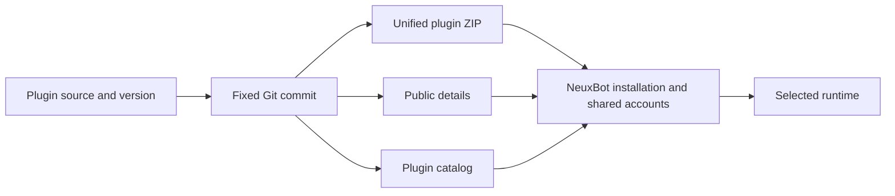
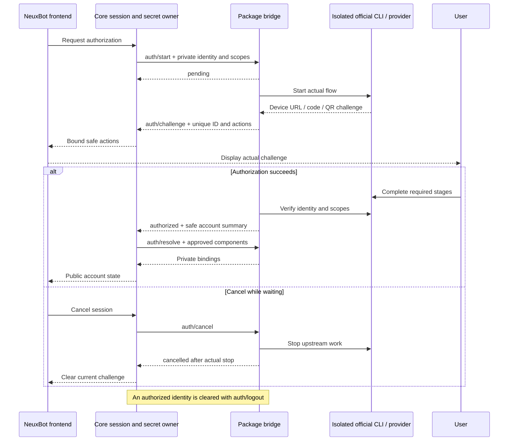

# Neux Plugins

[English](README.md) | [简体中文](README.zh-CN.md)

A library of plugins maintained for NeuxBot, including office integrations, developer tools, search, analytics, and other hosted MCP services. Each plugin has one complete Agent Plugins standard package and its own version under `plugins/`.

| Plugin | Capabilities |
| --- | --- |
| [GitHub](plugins/github/README.md) | Search repository code, follow issues and pull requests, inspect changes and check results |
| [Feishu Office](plugins/feishu-office/README.md) | Create and organize documents, manage table records, arrange events and follow up on tasks |
| [WeCom Office](plugins/wecom-office/README.md) | Manage documents and tables, arrange meetings, track tasks and work with email and files |

Each package owns its manifest and version. Packages declare the MCP services, skills and authorization they use. NeuxBot owns installation, updates, shared accounts and delivery to the selected runtime. This repository publishes one unified package per plugin.

## Plugin sources

- `plugins/github/`: one standard manifest, one official GitHub MCP declaration, business documentation, brand assets and package-owned device authorization.
- `plugins/feishu-office/`: one standard manifest, complete official skills and relative resources, business documentation, brand assets and package-owned authorization.
- `plugins/wecom-office/`: one standard manifest, 15 fixed official skills and their resources, bilingual descriptions and package-owned QR authorization.
- The other [plugin directories](plugins/) include hosted and local MCP packages with bilingual documentation. Their READMEs describe provider accounts, API keys, or local application requirements.
- `patches/`: reviewed provider isolation patches, regression sources, original licenses and provenance.
- `scripts/`: deterministic catalog/ZIP builds and independent fixed-source provider builds. Ignored `dist/` contains release artifacts; `.cache/` contains verified build inputs.

NeuxBot reads the HTTP catalog, verifies the unified plugin archive and attaches its fixed version to partners. Configuration and account lifecycle belong to NeuxBot. Runtime-specific delivery is handled by the host from that same package.

The manifest's `repository` and `extensions.com.openai.interface.developerName` identify the official capability project and brand: GitHub / `github/github-mcp-server`, and 飞书 / `larksuite/cli`. `author` identifies NeuxBot contributors as authors of the package wrapper and bridge; uniform `provenance.upstream` records the actual business capability author, version, license and repository used by the plugin information panel. Official service/skill authorship is not authorship of this packaging, and brand attribution is not official endorsement. See [third-party notices](THIRD_PARTY_NOTICES.md).



## Maintaining a standard package

Create `plugins/<key>/plugin.json` with the Agent Plugins 1.0.0 schema, identity, independent version, description, truthful author and license. Put Skills under `skills/` and MCP declarations in `mcp.json`. Preserve third-party source, scripts, relative references and executable modes. Record actual licenses and modifications in the [provenance contract](docs/PROVENANCE.md). Define each component once in the unified package.

Each plugin's English and Chinese README describes only its own capabilities, access requirements and practical uses. It contains no host roles, installation flow, chat prompts or language navigation; the host selects the document by system language. Standard English interface fields, optional localized display text and static PNG assets follow the [presentation maintenance guide](docs/MAINTAINING.md). A package without `.neuxbot/` remains a standard package.

## Declaration-driven authorization

MCP services and skill components remain declared by their standard files. Optional root `extensions.com.neuxbot.authentication` adds host integration: authentication strategy, scopes, preferred challenge action and exact authorized component bindings. It does not declare a second identity or component list.

Packages with an interactive authorization bridge use `extensions.com.neuxbot.authentication.strategy: plugin-command`, `protocol: neuxbot-auth/1`, trusted Node and a package-relative bridge entry. The frontend displays safe actions supplied by Core and sends cancellation requests. Optional [challenge notices](docs/AUTH-CHALLENGE-NOTICES.md) are declared by the package, apply only to the current challenge and use the host's fixed warning style. Core owns sessions, leases and private execution bindings. The bridge interprets its vendor flow; raw provider frames, credentials and private bindings do not enter the frontend.

Packages that use an API key declare a required secret in `extensions.com.neuxbot.configuration`. Hosted services such as Gojiberry bind the key to an MCP request header. Brave Search supplies the key to its bundled stdio server through an environment variable. Figma Desktop and Paper Desktop use the local application’s loopback MCP service.

- GitHub uses the official device OAuth flow through a fixed isolated GitHub CLI. It emits the actual `https://github.com/login/device` URL and one-time code, verifies account and granted scopes online, and resolves a private OAuth Bearer header only for the exact `github` MCP at `https://api.githubcopilot.com/mcp/`. The exact component binding is shared across supported CLI targets; target-specific differences must be declared explicitly. No PAT placeholder or managed app connector is bundled. `preferredAction: open-url` does not imply QR support.
- Feishu uses successive official application-creation and user-authorization QR challenges. An existing application without a user identity is a valid pending stage; only final online identity/scope verification marks it available. `preferredAction: show-qr` allows the frontend to prepare a QR placeholder while waiting for actual challenge actions. See the [Feishu bridge contract](plugins/feishu-office/.neuxbot/auth/README.md) and [GitHub bridge contract](plugins/github/.neuxbot/auth/README.md).



Provider download, integrity verification and dependency preparation failures return `dependency_unavailable`; actual login and account verification failures retain `authorization_failed`. The host reports the failed stage and never treats an unverified account or a dependency failure as successful authorization.

Provider programs are independent digest-locked dependencies downloaded by each plugin into its private data directory. The host does not bundle or download one vendor program per plugin. Package locks pin HTTPS asset URLs, sizes, hashes, fixed source, toolchain and isolation evidence. GitHub clears inherited CLI credentials and uses a private profile; its patched keyring service is bound to the canonical profile directory digest. Feishu uses its existing private profile and credential isolation. Trusted test overrides can supply the same program boundary without looking up user-global CLIs.


## WeCom Office

`plugins/wecom-office/` packages 15 official skills and their relative resources from the fixed `wecom-cli` 1.3.4 release commit. It pins five official npm platform archives and extracted binary digests, downloads them privately, and uses the official CLI QR flow. It does not install a global npm command or declare a legacy MCP endpoint. The shared skill routes installation and account changes through the managed plugin lifecycle; other upstream skill content is preserved.

The host must support PNG data URLs for `show-qr` challenges and merging verified private CLI paths for multiple plugins. Windows ARM64 has no official platform asset. See the [business overview](plugins/wecom-office/README.md) and [bridge guide](plugins/wecom-office/.neuxbot/auth/README.md).

## HTTP catalog and complete snapshots

Details and SKILL text are available before installation or authorization through digest-bound [read-only details sidecars](docs/DETAILS.md), independently of the complete installation ZIP.

The [plugin catalog](https://github.com/JieWaZi/neux-plugins/releases/latest/download/catalog.json) lists one stable version per published plugin, including hosted OAuth plugins. It uses schema version 1. Each entry binds its source commit, package path, archive URL and digest, and details URL, size, and digest.

A ZIP contains its complete standard package, source and license evidence, and the selected plugin's provider patches. Installation and portable catalog builds read the complete package. Separate business services and first-use provider dependencies still require network access. Clients verify the archive digest before extraction.

## Release a plugin

1. Bump the affected plugin's stable SemVer in `plugins/<key>/plugin.json` and merge the change into `main`. Keep the package key and name. For example, the first GitHub release after the existing `0.1.1` can use `0.1.2`. If a shared input changes several packages, bump and release each affected package.
2. Tag the merged commit as `<key>@<version>`, for example `github@0.1.2`, and push the tag. A release maintainer starts **Release plugin** from the protected `main` branch and passes the tag as input. Every job runs the reviewed scripts from that `main` commit. The build checks the tagged commit and manifest, then the publish job uploads the unified ZIP, public details and single-entry catalog to the fixed tag with Latest disabled.
3. The catalog job reads the current Latest release, updates its catalog entries, and publishes the complete `catalog.json` as Latest. Re-run failed jobs to resume. The workflow verifies existing assets before reusing them, fails on a same-version binding conflict, and retains a newer version already in the catalog.

Keep published tags, assets, and all provider binaries and notices referenced by package locks. See the [release guide](docs/RELEASING.md) for repository setup, the dispatch command, and recovery.

## Build and test locally

Use Node 22+ and Git. Build commands read a committed snapshot and write local artifacts.

```sh
npm ci
npm test
node scripts/build-catalog.mjs HEAD v0.1.2-dev
```

Run `npm run build:release -- HEAD github@0.1.2 /absolute/path/to/output` to build the GitHub package after committing manifest version `0.1.2`. The output contains `catalog.json`, `github.zip` and `github.details.json`. Node 22+ and Git provide the release toolchain.

The portable builder validates package declarations, provenance, dependency locks and local asset hashes before replacing the output. All-package development builds preserve `dist/providers`. Use a separate output directory for a single-plugin rehearsal.

Provider rebuilds are deliberate independent operations, not a prerequisite for catalog builds:

```sh
node scripts/build-github-provider.mjs
node scripts/build-lark-provider.mjs
```

Each fixed-source provider build verifies source and isolation, cross-compiles six platforms, and collects dependency license texts. GitHub and Feishu use fixed provider assets from the dedicated `v0.1.4-providers` release. When relocating verified bytes, regenerate the lock bindings and publish the assets at their new fixed URLs before tagging the dependent plugin releases. Upstream versions and authorship come from `provenance.upstream`. See the [provider build and publication steps](docs/RELEASING.md).

The root [MIT license](LICENSE) covers NeuxBot-authored packaging. Third-party content and brand assets retain their actual terms and disclosed license gaps.
