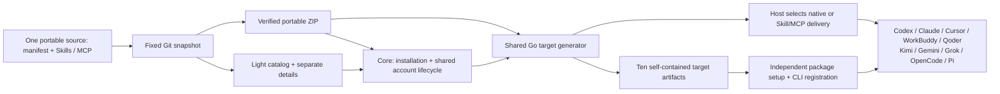
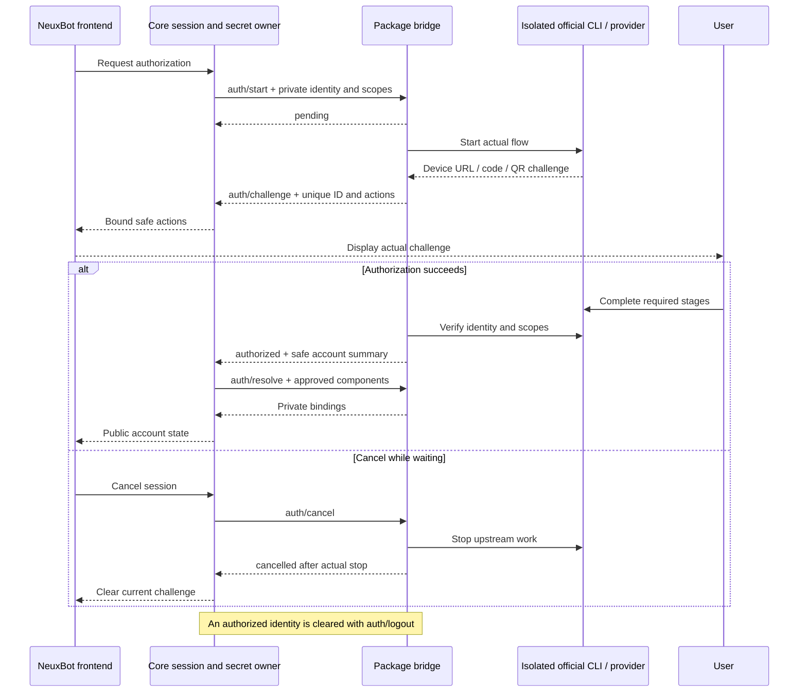

# Neux Plugins

[English](README.md) | [简体中文](README.zh-CN.md)

A library of self-maintained portable Agent Plugins packages for GitHub code review and collaboration, and Feishu and WeCom documents, tables, calendars and tasks. Each entry is one complete package under `plugins/`.

| Plugin | Capabilities |
| --- | --- |
| [GitHub](plugins/github/README.md) | Search repository code, follow issues and pull requests, inspect changes and check results |
| [Feishu Office](plugins/feishu-office/README.md) | Create and organize documents, manage table records, arrange events and follow up on tasks |
| [WeCom Office](plugins/wecom-office/README.md) | Manage documents and tables, arrange meetings, track tasks and work with email and files |

The root is a library and marketplace, not a single plugin, so it has no root single-plugin `plugin.json`. Each package owns its standard identity and components. The library maintains one portable definition per capability. The shared Go generator validates target declarations and builds the CLI artifacts from that same source; target artifacts do not introduce separate business implementations.

## Portable sources and generated targets

- `plugins/github/`: one standard manifest, one official GitHub MCP declaration, business documentation, brand assets and package-owned device authorization.
- `plugins/feishu-office/`: one standard manifest, complete official skills and relative resources, business documentation, brand assets and package-owned authorization.
- `plugins/wecom-office/`: one standard manifest, 15 fixed official skills and their resources, bilingual descriptions and package-owned QR authorization.
- `.agents/plugins/marketplace.json`: local entries pointing at those actual portable sources. CLI-specific manifests and registration descriptors are generated and validated by the shared tool.
- `patches/`: reviewed provider isolation patches, regression sources, original licenses and provenance.
- `scripts/`: deterministic catalog/ZIP builds and independent fixed-source provider builds. Ignored `dist/` contains release artifacts; `.cache/` contains verified build inputs.

NeuxBot installs plugins from this maintained library’s HTTP catalog and delivers the fixed package to the selected runtime through the shared generator. It provides no public local-directory or ZIP import. Independent CLI use consumes the generated artifact for that CLI and the package-owned setup/launcher described in [native delivery](docs/NATIVE-DELIVERY.md). Native installation, registration and accounts stay in the CLI’s environment and are not recorded as host-managed resources. The selected CLI uses its real native mechanism or the equivalent Skill/MCP configuration; generated artifacts alone do not prove real loading or business calls.

The manifest's `repository` and `extensions.com.openai.interface.developerName` identify the official capability project and brand: GitHub / `github/github-mcp-server`, and 飞书 / `larksuite/cli`. `author` identifies NeuxBot contributors as authors of the package wrapper and bridge; uniform `provenance.upstream` records the actual business capability author, version, license and repository used by the plugin information panel. Official service/skill authorship is not authorship of this packaging, and brand attribution is not official endorsement. See [third-party notices](THIRD_PARTY_NOTICES.md).



## Maintaining a standard package

Create `plugins/<key>/plugin.json` with the Agent Plugins 1.0.0 `$schema`, identity, version, description, truthful author and license. Put skills under fixed `skills/` and MCP servers in `mcp.json`, using the [official packaging fields](https://developers.openai.com/plugins/build/plugins). Preserve third-party source, scripts, relative references and executable modes. Copy the reviewed upstream content needed by this package and maintain it locally, with actual licenses and modifications recorded in the [uniform provenance contract](docs/PROVENANCE.md). Keep one authoritative component definition. The shared generator verifies registered native thin declarations against those components and derives missing target entries. The three curated source packages remain portable; per-CLI outputs belong to the generated release artifacts, not separate hand-maintained capability packages.

Each plugin's English and Chinese README describes only its own capabilities, access requirements and practical uses. It contains no host roles, installation flow, chat prompts or language navigation; the host selects the document by system language. Standard English interface fields, optional localized display text and static PNG assets follow the [presentation maintenance guide](docs/MAINTAINING.md). A package without `.neuxbot/` remains a standard package.

## Declaration-driven authorization

MCP services and skill components remain declared by their standard files. Optional root `extensions.com.neuxbot.authentication` adds host integration: authentication strategy, scopes, preferred challenge action and exact authorized component bindings. It does not declare a second identity or component list.

Packages requiring authorization use `extensions.com.neuxbot.authentication.strategy: plugin-command`, `protocol: neuxbot-auth/1`, trusted Node and a package-relative bridge entry. The frontend displays safe actions supplied by Core and sends cancellation requests. Optional [challenge notices](docs/AUTH-CHALLENGE-NOTICES.md) are declared by the package, apply only to the current challenge and use the host's fixed warning style. Core owns sessions, leases and private execution bindings. The bridge interprets its vendor flow; raw provider frames, credentials and private bindings do not enter the frontend.

- GitHub uses the official device OAuth flow through a fixed isolated GitHub CLI. It emits the actual `https://github.com/login/device` URL and one-time code, verifies account and granted scopes online, and resolves a private OAuth Bearer header only for the exact `github` MCP at `https://api.githubcopilot.com/mcp/`. The exact component binding is shared across supported CLI targets; target-specific differences must be declared explicitly. No PAT placeholder or managed app connector is bundled. `preferredAction: open-url` does not imply QR support.
- Feishu uses successive official application-creation and user-authorization QR challenges. An existing application without a user identity is a valid pending stage; only final online identity/scope verification marks it available. `preferredAction: show-qr` allows the frontend to prepare a QR placeholder while waiting for actual challenge actions. See the [Feishu bridge contract](plugins/feishu-office/.neuxbot/auth/README.md) and [GitHub bridge contract](plugins/github/.neuxbot/auth/README.md).



Provider download, integrity verification and dependency preparation failures return `dependency_unavailable`; actual login and account verification failures retain `authorization_failed`. The host reports the failed stage and never treats an unverified account or a dependency failure as successful authorization.

Provider programs are independent digest-locked dependencies downloaded by each plugin into its private data directory. The host does not bundle or download one vendor program per plugin. Package locks pin HTTPS asset URLs, sizes, hashes, fixed source, toolchain and isolation evidence. GitHub clears inherited CLI credentials and uses a private profile; its patched keyring service is bound to the canonical profile directory digest. Feishu uses its existing private profile and credential isolation. Trusted test overrides can supply the same program boundary without looking up user-global CLIs.


## WeCom Office

`plugins/wecom-office/` packages 15 official skills and their relative resources from the fixed `wecom-cli` 1.3.4 release commit. It pins five official npm platform archives and extracted binary digests, downloads them privately, and uses the official CLI QR flow. It does not install a global npm command or declare a legacy MCP endpoint. The shared skill routes installation and account changes through the managed plugin lifecycle; other upstream skill content is preserved.

The host must support PNG data URLs for `show-qr` challenges and merging verified private CLI paths for multiple plugins. Windows ARM64 has no official platform asset. See the [business overview](plugins/wecom-office/README.md) and [bridge guide](plugins/wecom-office/.neuxbot/auth/README.md).

## HTTP catalog and complete snapshots

Details and SKILL text are available before installation or authorization through digest-bound [read-only details sidecars](docs/DETAILS.md), independently of the complete installation ZIP.

Use the [latest catalog](https://github.com/JieWaZi/neux-plugins/releases/latest/download/catalog.json) or [fixed v0.1.2 catalog](https://github.com/JieWaZi/neux-plugins/releases/download/v0.1.2/catalog.json). Each `{schemaVersion:1,entries:[...]}` entry records `key`, full `sourceCommit`, `archiveURL`, `archiveSHA256`, `packagePath: plugins/<key>`, standard `name`, `version`, English `description` and `format: agent-plugins`. Optional localized maps and a validated embedded icon support presentation before package download; components are read from the actual package.

A ZIP contains its complete standard package, applicable local Codex index, source/license evidence and public patches. No upstream Git or HTTP materialization is required by installation or ordinary catalog builds. Separate business services and first-use provider dependencies still require network access. Clients verify the selected archive digest before extraction. Installed snapshots remain identified by their source commit and digest when test-release assets change.

## Build and test release

See [multi-CLI build and independent setup](docs/NATIVE-DELIVERY.md) for the shared Go packager, ten self-contained target artifacts, and native account launchers.

Node 22+ and Git build a committed portable snapshot; dirty workspace files and timestamps do not enter the result:

```sh
npm ci
npm test
node scripts/build-catalog.mjs HEAD v0.1.2
```

For a complete multi-CLI build, use `NEUX_PLUGIN_PACKAGER=/absolute/path/to/pluginpack node scripts/build-release.mjs HEAD v0.1.3-dev`. It invokes the same Go generator as the host and emits the portable originals, separate details, 30 CLI target ZIPs and source/digest receipts; the exact tool lock and development override boundary are documented in [native delivery](docs/NATIVE-DELIVERY.md).

The portable catalog builder validates canonical packages, the shared provenance schema, dependency locks and local asset hashes, produces deterministic ZIPs and catalog, and replaces its output after validation. The CLI replaces the `dist` output directory while preserving `dist/providers`; use the exported `buildCatalog({root,out,sourceCommit})` with a separate output directory when existing unrelated receipts must be retained.

Provider rebuilds are deliberate independent operations, not a prerequisite for catalog builds:

```sh
node scripts/build-github-provider.mjs
node scripts/build-lark-provider.mjs
```

Each fixed-source provider build verifies source and isolation tests, cross-compiles six platforms and collects actual dependency license texts. Existing provider locks continue to reference their verified `v0.1.0` assets; releasing package metadata and icons does not rebuild those dependencies. Protocol/schema versions and internal package identities have their own meaning: the internal package identity remains `0.1.1`, while release tags identify separately reviewed snapshots. A local target build does not publish a release. User-facing version and authorship come directly from `provenance.upstream`; Feishu shows `v1.0.98`, while an unpinned hosted MCP service declares no fixed version. Fixed references record verified inputs, not an unchecked claim that every upstream dependency is latest.

With explicit authorization, publish each verified snapshot under a new release tag without replacing existing tags or assets. Publish needed provider binaries and notices before the catalog/ZIPs, then verify the final tag target, sourceCommit and all asset digests over HTTP. Existing installed snapshots remain unchanged. Automated tests, cross compilation and publication do not substitute for real account, platform, runtime or UI acceptance.

The root [MIT license](LICENSE) covers NeuxBot-authored packaging. Third-party content and brand assets retain their actual terms and disclosed license gaps.
