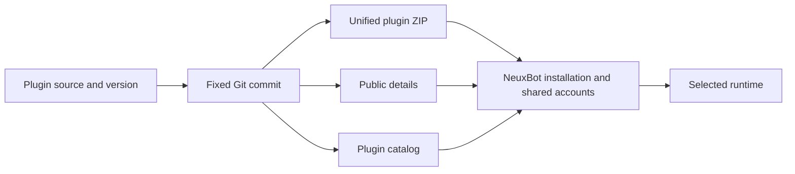
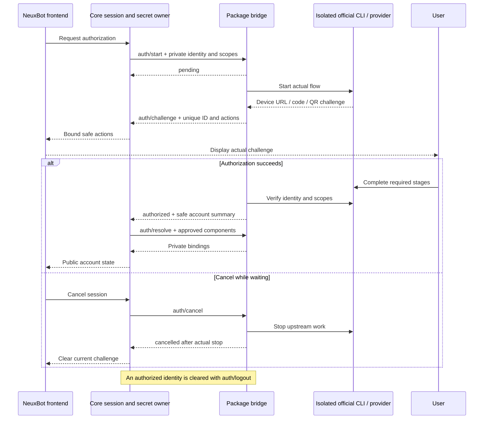

# Neux Plugins

[English](README.md) | [简体中文](README.zh-CN.md)

A library of Agent Plugins packages maintained for NeuxBot. Each package has an independent version and declares its MCP services, skills, and authorization.

## Plugin catalog

The 165 entries below list the source packages and their manifest versions. The online catalog shows currently installable versions. [Online catalog](https://github.com/JieWaZi/neux-plugins/releases/latest/download/catalog.json) · [GitHub releases](https://github.com/JieWaZi/neux-plugins/releases)

[Productivity](#productivity) · [Developer tools](#developer-tools) · [Data and analytics](#data-and-analytics) · [Research](#research) · [Design](#design) · [Automation](#automation) · [Documents](#documents) · [Other](#other)

### Productivity

| Plugin | Version | Capabilities |
| --- | --- | --- |
| [Airtable](plugins/airtable/README.md) | `0.1.0` | Read and update records and inspect base schemas in Airtable. |
| [Akiflow](plugins/akiflow/README.md) | `0.1.0` | Review your Akiflow tasks and calendar when planning a workday. |
| [Ando](plugins/ando/README.md) | `0.1.0` | Bring context from Ando team channels and discussion threads into a task. |
| [Atlassian](plugins/atlassian/README.md) | `0.1.0` | Find and work with Jira issues and Confluence content through Atlassian Rovo. |
| [Attio](plugins/attio/README.md) | `0.1.0` | Look up people, companies, and deal records in your Attio workspace. |
| [Basecamp](plugins/basecamp/README.md) | `0.1.0` | Review project messages, to-dos, and progress in Basecamp. |
| [beehiiv](plugins/beehiiv/README.md) | `0.1.0` | Review beehiiv publications, newsletter activity, and audience data. |
| [Circleback](plugins/circleback/README.md) | `0.1.0` | Find meeting notes and follow-up items in Circleback. |
| [ClickUp](plugins/clickup/README.md) | `0.1.0` | Review tasks and project information in your ClickUp workspace. |
| [Cobrain](plugins/cobrain/README.md) | `0.1.0` | Retrieve shared notes and project context from Cobrain memory. |
| [Dart](plugins/dart/README.md) | `0.1.0` | Work with project tasks and team planning in Dart. |
| [Eden](plugins/eden/README.md) | `0.1.0` | Research social content and review publishing activity in Eden. |
| [Era](plugins/era/README.md) | `0.1.0` | Review accounts, transactions, and spending insights connected to Era. |
| [Fastmail](plugins/fastmail/README.md) | `0.1.0` | Find information in your authorized Fastmail messages and calendars. |
| [Feishu](plugins/feishu-office/README.md) | `0.1.2` | Write Feishu documents, manage tables, schedule events and follow up on tasks. |
| [Fellow](plugins/fellow/README.md) | `0.1.0` | Find meeting notes, decisions, and assignments in Fellow. |
| [Fireflies.ai](plugins/fireflies/README.md) | `0.1.0` | Search Fireflies meeting transcripts and review recorded takeaways. |
| [Granola](plugins/granola/README.md) | `0.1.0` | Find your Granola meeting notes and revisit decisions from past conversations. |
| [Greenhouse](plugins/greenhouse/README.md) | `0.1.0` | Review roles and recruiting activity in Greenhouse. |
| [Help Scout](plugins/helpscout/README.md) | `0.1.0` | Look up customer conversations and mailbox activity in Help Scout. |
| [HighLevel](plugins/highlevel/README.md) | `0.1.2` | Find CRM records, review opportunities, and check calendars in a HighLevel sub-account. |
| [Hindsight](plugins/hindsight/README.md) | `0.1.2` | Search and summarize memories across Hindsight Cloud memory banks. |
| [Honcho](plugins/honcho/README.md) | `0.1.2` | Find prior conversation context and retrieve what Honcho remembers about people and projects. |
| [Intercom](plugins/intercom/README.md) | `0.1.0` | Find customer conversations and support records in Intercom. |
| [Kajabi](plugins/kajabi/README.md) | `0.1.0` | Review the products, content, and account information available in Kajabi. |
| [Klaviyo](plugins/klaviyo/README.md) | `0.1.0` | Review audience and campaign data in your Klaviyo account. |
| [Knowify](plugins/knowify/README.md) | `0.1.0` | Review jobs and commercial project records in Knowify. |
| [lemlist](plugins/lemlist/README.md) | `0.1.0` | Review sales campaigns and prospect activity in lemlist. |
| [LMCP](plugins/localmcp/README.md) | `0.1.0` | Access the computer apps you have shared through LMCP. |
| [MailerLite](plugins/mailerlite/README.md) | `0.1.0` | Review subscribers and email campaign activity in MailerLite. |
| [monday.com](plugins/monday/README.md) | `0.1.0` | Inspect work boards, items, and team project status in monday.com. |
| [Notion](plugins/notion/README.md) | `0.1.2` | Search and work with pages and databases in a Notion workspace. |
| [Pipedrive](plugins/pipedrive/README.md) | `0.1.0` | Review deals, contacts, and pipeline progress in Pipedrive. |
| [Planning Center](plugins/planningcenter/README.md) | `0.1.0` | Review the people and organizational resources available in Planning Center. |
| [Plaud](plugins/plaud/README.md) | `0.1.0` | Find Plaud recordings, transcripts, and meeting records. |
| [Pylon](plugins/pylon/README.md) | `0.1.0` | Find customer requests, accounts, and support history in Pylon. |
| [Quo](plugins/quo/README.md) | `0.1.0` | Review authorized business calls, text conversations, and contacts in Quo. |
| [Raindrop.io](plugins/raindrop/README.md) | `0.1.0` | Search and organize bookmarks from your Raindrop.io collections. |
| [Resend](plugins/resend/README.md) | `0.1.0` | Review email delivery and manage Resend email resources within the API key's permissions. |
| [Roam Research](plugins/roam/README.md) | `0.1.0` | Search the notes and linked ideas in your Roam Research graph. |
| [Spacefast](plugins/spacefast/README.md) | `0.1.0` | Find the hosted pages and Spaces available in Spacefast. |
| [Sunsama](plugins/sunsama/README.md) | `0.1.0` | Review your daily plan, tasks, and calendar information in Sunsama. |
| [Superhuman Mail](plugins/superhuman/README.md) | `0.1.0` | Find messages and related threads in Superhuman Mail. |
| [Supermemory](plugins/supermemory/README.md) | `0.1.0` | Find saved information and manage knowledge available in Supermemory. |
| [Todoist](plugins/todoist/README.md) | `0.1.0` | Review the projects and tasks in your Todoist account. |
| [Trello](plugins/trello/README.md) | `0.1.0` | Review boards, lists, and cards you can access in Trello. |
| [Typefully](plugins/typefully/README.md) | `0.1.0` | Find social writing drafts and review scheduled posts in Typefully. |
| [WeCom](plugins/wecom-office/README.md) | `0.1.2` | Create WeCom documents, manage tables, arrange meetings and follow up on work. |

### Developer tools

| Plugin | Version | Capabilities |
| --- | --- | --- |
| [1inch](plugins/1inch/README.md) | `0.1.2` | Find 1inch Business API documentation, SDK examples and public Aqua liquidity analytics. |
| [21st](plugins/21st/README.md) | `0.1.0` | Explore reusable interface components and design references for web projects. |
| [Algolia](plugins/algolia/README.md) | `0.1.0` | Search the Algolia indexes available to your account. |
| [AppSignal](plugins/appsignal/README.md) | `0.1.0` | Investigate application errors and performance using AppSignal data. |
| [AWS Knowledge](plugins/aws-knowledge/README.md) | `0.1.2` | Search official AWS documentation and verify service, API and CloudFormation availability by region. |
| [Base44](plugins/base44/README.md) | `0.1.0` | Access Base44 app projects and the resources available in your workspace. |
| [Better Stack](plugins/betterstack/README.md) | `0.1.0` | Check observability and incident information in Better Stack. |
| [Buildkite](plugins/buildkite/README.md) | `0.1.0` | Inspect Buildkite pipelines, recent builds, and job outcomes. |
| [Clerk](plugins/clerk/README.md) | `0.1.0` | Inspect users and organizations in the Clerk projects you can access. |
| [Cloudflare](plugins/cloudflare/README.md) | `0.1.0` | Inspect the Cloudflare account resources available through its MCP service. |
| [Convex](plugins/convex/README.md) | `0.1.2` | Get Convex guidance for new apps, existing projects and backends that need to scale. |
| [DeepWiki](plugins/deepwiki/README.md) | `0.1.2` | Navigate generated documentation for public GitHub repositories and ask questions about their code. |
| [GitHub](plugins/github/README.md) | `0.1.2` | Search GitHub repositories, issues and pull requests, and assist with code review and collaboration. |
| [Grafana Cloud](plugins/grafana/README.md) | `0.1.0` | Investigate metrics, logs, and dashboards in Grafana Cloud. |
| [Hostinger](plugins/hostinger/README.md) | `0.1.0` | Inspect sites and hosting resources available in Hostinger. |
| [LaunchDarkly](plugins/launchdarkly/README.md) | `0.1.0` | Inspect feature flags and environment configuration in LaunchDarkly. |
| [Linear](plugins/linear/README.md) | `0.1.2` | Search issues, inspect projects, and manage work items in a Linear workspace. |
| [Lovable](plugins/lovable/README.md) | `0.1.0` | Review the app projects available in your Lovable workspace. |
| [Neon](plugins/neon/README.md) | `0.1.0` | Work with the Postgres projects and branches available in Neon. |
| [Netlify](plugins/netlify/README.md) | `0.1.0` | Inspect sites, deploys, and project resources in Netlify. |
| [Postman](plugins/postman/README.md) | `0.1.0` | Inspect API collections, workspaces, and other Postman resources. |
| [Prisma](plugins/prisma/README.md) | `0.1.0` | Review database and project resources in Prisma. |
| [Railway](plugins/railway/README.md) | `0.1.0` | Inspect Railway projects, service deployments, and their status. |
| [Render](plugins/render/README.md) | `0.1.2` | Inspect Render services, deployments, and operational logs in your workspace. |
| [Runpod](plugins/runpod/README.md) | `0.1.0` | Inspect the cloud compute resources available in Runpod. |
| [Sanity](plugins/sanity/README.md) | `0.1.0` | Explore structured content in your Sanity projects and datasets. |
| [Sentry](plugins/sentry/README.md) | `0.1.0` | Investigate errors and performance issues in your Sentry projects. |
| [Statsig](plugins/statsig/README.md) | `0.1.0` | Explore feature gates and experiment information in Statsig. |
| [Svelte](plugins/svelte/README.md) | `0.1.2` | Look up Svelte and SvelteKit documentation, check component code and prepare examples for the Svelte Playground. |
| [Twilio Docs](plugins/twilio-docs/README.md) | `0.1.2` | Search public Twilio developer documentation and retrieve API endpoints, parameters and response schemas. |
| [Wix](plugins/wix/README.md) | `0.1.0` | Work with the sites and business resources available in Wix. |
| [WorkOS](plugins/workos/README.md) | `0.1.0` | Review identity and organization resources available in WorkOS. |

### Data and analytics

| Plugin | Version | Capabilities |
| --- | --- | --- |
| [Aave](plugins/aave/README.md) | `0.1.2` | Inspect Aave lending markets, public wallet positions and governance across V3 and V4. |
| [Alpha Vantage](plugins/alphavantage/README.md) | `0.1.0` | Look up financial time series and market information from Alpha Vantage. |
| [Amplitude](plugins/amplitude/README.md) | `0.1.0` | Investigate product usage and behavioral analytics in Amplitude. |
| [Artie](plugins/artie/README.md) | `0.1.0` | Inspect database replication pipelines and their status in Artie. |
| [ClickHouse Cloud](plugins/clickhouse/README.md) | `0.1.0` | Explore databases and query resources in ClickHouse Cloud. |
| [Coinbase](plugins/coinbase/README.md) | `0.1.0` | Look up Coinbase market information and the records available to your account. |
| [CoinGecko](plugins/coingecko/README.md) | `0.1.2` | Retrieve cryptocurrency prices, historical market data and decentralized exchange pool data from CoinGecko. |
| [Hex](plugins/hex/README.md) | `0.1.0` | Explore projects, notebooks, and analysis available through your Hex workspace. |
| [IBKR](plugins/ibkr/README.md) | `0.1.0` | Review the account and market information available through Interactive Brokers. |
| [Kensho](plugins/kensho/README.md) | `0.1.0` | Explore the financial research and company data available to your Kensho account. |
| [Massive](plugins/massive/README.md) | `0.1.0` | Look up market data available to your Massive subscription. |
| [Navan](plugins/navan/README.md) | `0.1.0` | Review available business travel and expense records in Navan. |
| [PostHog](plugins/posthog/README.md) | `0.1.2` | Explore product events, inspect feature flags, and query PostHog analytics. |
| [Ryze AI](plugins/ryze/README.md) | `0.1.0` | Review advertising campaign performance from accounts connected to Ryze AI. |
| [TradingView](plugins/tradingview/README.md) | `0.1.0` | Look up TradingView market information for research. |
| [Truthifi](plugins/truthifi/README.md) | `0.1.0` | Review data from investment accounts connected to Truthifi. |
| [Ubersuggest](plugins/ubersuggest/README.md) | `0.1.0` | Research search terms and site visibility with Ubersuggest data. |
| [vidIQ](plugins/vidiq/README.md) | `0.1.0` | Review video, channel, and topic research from vidIQ. |
| [Windsor.ai](plugins/windsor/README.md) | `0.1.0` | Explore marketing and analytics data from your connected Windsor.ai sources. |

### Research

| Plugin | Version | Capabilities |
| --- | --- | --- |
| [Amplemarket](plugins/amplemarket/README.md) | `0.1.0` | Research leads and review sales outreach in Amplemarket. |
| [Apollo](plugins/apollo/README.md) | `0.1.0` | Research companies, contacts, and sales prospects in Apollo. |
| [Brave Search](plugins/brave-search/README.md) | `0.1.0` | Search the public web, news, images, videos, and places with Brave Search. |
| [Bright Data](plugins/brightdata/README.md) | `0.1.0` | Retrieve public web data through the services enabled in Bright Data. |
| [Context7](plugins/context7/README.md) | `0.1.2` | Find indexed library documentation and code examples for the version your project uses. |
| [DataForSEO](plugins/dataforseo/README.md) | `0.1.0` | Retrieve search rankings, keyword data, and related SEO research. |
| [Dealroom](plugins/dealroom/README.md) | `0.1.0` | Research startups, investors, and funding activity with Dealroom data. |
| [Exa](plugins/exa/README.md) | `0.1.2` | Search the public web and retrieve page content through Exa. |
| [Firecrawl](plugins/firecrawl/README.md) | `0.1.0` | Search public web pages and collect structured content with Firecrawl. |
| [Gojiberry](plugins/gojiberry/README.md) | `0.1.0` | Find leads, inspect outreach campaigns, and review conversations in Gojiberry. |
| [Harmonic](plugins/harmonic/README.md) | `0.1.0` | Research companies, people, and investors using Harmonic data. |
| [Hugging Face](plugins/huggingface/README.md) | `0.1.2` | Discover public models, datasets and Spaces, and inspect repository metadata and files on the Hugging Face Hub. |
| [Parallel](plugins/parallel/README.md) | `0.1.2` | Search the public web, retrieve source pages and organize evidence for a decision. |
| [Readwise](plugins/readwise/README.md) | `0.1.0` | Find saved highlights and reading material in Readwise. |
| [Scrape Creators](plugins/scrapecreators/README.md) | `0.1.0` | Retrieve public creator and social content data for research. |
| [SE Ranking](plugins/seranking/README.md) | `0.1.0` | Review ranking, website, and keyword research in SE Ranking. |
| [Tavily](plugins/tavily/README.md) | `0.1.0` | Research public web sources with Tavily search and extraction capabilities. |
| [You.com](plugins/you/README.md) | `0.1.0` | Research web sources and retrieve supporting information through You.com. |

### Design

| Plugin | Version | Capabilities |
| --- | --- | --- |
| [Canva](plugins/canva/README.md) | `0.1.0` | Find designs and work with creative assets available in your Canva account. |
| [Cloudinary](plugins/cloudinary/README.md) | `0.1.0` | Find and manage digital media available through Cloudinary's asset service. |
| [Excalidraw](plugins/excalidraw/README.md) | `0.1.2` | Create sketch-style diagrams and export them to Excalidraw for editing. |
| [fal](plugins/fal/README.md) | `0.1.0` | Use hosted media models and inspect generation results in fal. |
| [Figma Desktop](plugins/figma/README.md) | `0.1.0` | Inspect design context from Figma Desktop on the same computer. |
| [Higgsfield](plugins/higgsfield/README.md) | `0.1.0` | Work with creative projects and media generation in Higgsfield. |
| [Magic Patterns](plugins/magicpatterns/README.md) | `0.1.0` | Work with interface designs and prototypes in Magic Patterns. |
| [Magnific](plugins/magnific/README.md) | `0.1.0` | Use the creative media tools available to your Magnific account. |
| [Mobbin](plugins/mobbin/README.md) | `0.1.0` | Find interface examples and product design references in Mobbin. |
| [Mural](plugins/mural/README.md) | `0.1.0` | Find and use visual collaboration boards in Mural. |
| [OpenArt](plugins/openart/README.md) | `0.1.0` | Work with your creative media projects and assets in OpenArt. |
| [OpusClip](plugins/opusclip/README.md) | `0.1.0` | Review video projects and short clips in OpusClip. |
| [Paper Desktop](plugins/paper/README.md) | `0.1.0` | Inspect and edit the open design file in Paper Desktop on the same computer. |
| [Picsart](plugins/picsart/README.md) | `0.1.0` | Use creative editing and media generation services from Picsart. |
| [Riverside](plugins/riverside/README.md) | `0.1.0` | Work with studio recordings and media projects in Riverside. |
| [Runway](plugins/runway/README.md) | `0.1.0` | Work with Runway media generation and your creative workspace. |
| [Sunra](plugins/sunra/README.md) | `0.1.0` | Use media generation resources available in your Sunra projects. |
| [Webflow](plugins/webflow/README.md) | `0.1.0` | Explore websites and CMS content in your Webflow account. |

### Automation

| Plugin | Version | Capabilities |
| --- | --- | --- |
| [AgentMail](plugins/agentmail/README.md) | `0.1.0` | Bring authorized AgentMail inboxes and email conversations into your work. |
| [Bird](plugins/bird/README.md) | `0.1.0` | Review available messaging and customer communication records in Bird. |
| [Blotato](plugins/blotato/README.md) | `0.1.0` | Review connected social channels and prepare content with Blotato. |
| [Browserless](plugins/browserless/README.md) | `0.1.0` | Use Browserless capabilities for browser-based tasks and page extraction. |
| [Buffer](plugins/buffer/README.md) | `0.1.0` | Review connected social channels and publishing schedules in Buffer. |
| [Composio](plugins/composio/README.md) | `0.1.2` | Discover and use the actions available in apps linked to Composio Connect. |
| [Customer.io](plugins/customerio/README.md) | `0.1.0` | Review customer profiles and campaign information in Customer.io. |
| [IFTTT](plugins/ifttt/README.md) | `0.1.0` | Review connected services and available automations in IFTTT. |
| [Postiz](plugins/postiz/README.md) | `0.1.2` | Review connected social channels and work with posts scheduled in Postiz. |
| [Speko](plugins/speko/README.md) | `0.1.0` | Review voice agents and associated call records in Speko. |
| [TinyFish](plugins/tinyfish/README.md) | `0.1.0` | Run supported browser-based research and web automation tasks through TinyFish. |
| [TryPost](plugins/trypost/README.md) | `0.1.0` | Review connected social channels and prepare publishing schedules in TryPost. |
| [Zapier](plugins/zapier/README.md) | `0.1.0` | Use the connected app capabilities you have configured in Zapier. |

### Documents

| Plugin | Version | Capabilities |
| --- | --- | --- |
| [Craft](plugins/craft/README.md) | `0.1.0` | Find and work with documents in your Craft spaces. |
| [Guru](plugins/guru/README.md) | `0.1.0` | Search the verified knowledge available in your Guru workspace. |
| [PandaDoc](plugins/pandadoc/README.md) | `0.1.0` | Find proposals, contracts, and other available PandaDoc documents. |

### Other

| Plugin | Version | Capabilities |
| --- | --- | --- |
| [Airwallex](plugins/airwallex/README.md) | `0.1.0` | Review balances, payment activity, and other records available in Airwallex. |
| [DeepLedger](plugins/deepledger/README.md) | `0.1.0` | Review bookkeeping records from services connected to DeepLedger. |
| [Extend](plugins/extend/README.md) | `0.1.0` | Review virtual card and spending activity available in Extend. |
| [Fanvue](plugins/fanvue/README.md) | `0.1.0` | Work with creator account information available through Fanvue. |
| [freee](plugins/freee/README.md) | `0.1.0` | Review the accounting records available to your freee organization. |
| [GoDaddy](plugins/godaddy/README.md) | `0.1.2` | Generate domain name ideas and check public availability through GoDaddy. |
| [Mercury](plugins/mercury/README.md) | `0.1.0` | Review banking activity and transaction records in Mercury. |
| [Monarch](plugins/monarch/README.md) | `0.1.0` | Review personal account activity and budgets in Monarch. |
| [RevenueCat](plugins/revenuecat/README.md) | `0.1.2` | Review RevenueCat subscription products, offerings, and entitlements for a project. |
| [Square](plugins/square/README.md) | `0.1.0` | Review available merchant, payment, and order information in Square. |
| [Stripe](plugins/stripe/README.md) | `0.1.0` | Review the payment and billing resources available to your Stripe account. |
| [Tessie](plugins/tessie/README.md) | `0.1.2` | Check vehicle status, battery charge, and recent charging activity from Tessie. |
| [Wellness Project](plugins/wellnessproject/README.md) | `0.1.0` | Review fitness, nutrition, and other wellness records in Wellness Project. |
| [Whop](plugins/whop/README.md) | `0.1.0` | Explore the products and community resources available to your Whop account. |

## Repository layout

- `plugins/` contains the unified packages, with English and Simplified Chinese documentation on capabilities and access requirements.
- `patches/` contains provider isolation patches, regression sources, original licenses, and provenance.
- `scripts/` contains the catalog, package, and fixed-source provider builders.

NeuxBot reads the HTTP catalog, verifies the unified plugin archive and attaches its fixed version to partners. Configuration and account lifecycle belong to NeuxBot. Runtime-specific delivery is handled by the host from that same package.

The manifest's `repository` and `extensions.com.openai.interface.developerName` identify the official capability project and brand: GitHub / `github/github-mcp-server`, and 飞书 / `larksuite/cli`. `author` identifies NeuxBot contributors as authors of the package wrapper and bridge; uniform `provenance.upstream` records the actual business capability author, version, license and repository used by the plugin information panel. Official service/skill authorship is not authorship of this packaging, and brand attribution is not official endorsement. See [third-party notices](THIRD_PARTY_NOTICES.md).



## Maintaining a standard package

Create `plugins/<key>/plugin.json` with the Agent Plugins 1.0.0 schema, identity, independent version, description, truthful author and license. Put Skills under `skills/` and MCP declarations in `mcp.json`. Preserve third-party source, scripts, relative references and executable modes. Record actual licenses and modifications in the [provenance contract](docs/PROVENANCE.md). Define each component once in the unified package.

Each plugin's English and Chinese README describes only its own capabilities, access requirements and practical uses. It contains no host roles, installation flow, chat prompts or language navigation; the host selects the document by system language. Standard English interface fields, optional localized display text and static PNG assets follow the [presentation maintenance guide](docs/MAINTAINING.md). A package without `.neuxbot/` remains a standard package.

## Declaration-driven authorization

MCP services and skill components remain declared by their standard files. Optional root `extensions.com.neuxbot.authentication` adds host integration: authentication strategy, scopes, preferred challenge action and exact authorized component bindings. It does not declare a second identity or component list.

Packages with an interactive authorization bridge use `extensions.com.neuxbot.authentication.strategy: plugin-command`, `protocol: neuxbot-auth/1`, trusted Node and a package-relative bridge entry. The frontend displays safe actions supplied by Core and sends cancellation requests. Optional [challenge notices](docs/AUTH-CHALLENGE-NOTICES.md) are declared by the package, apply only to the current challenge and use the host's fixed warning style. Core owns sessions, leases and private execution bindings. The bridge interprets its vendor flow; raw provider frames, credentials and private bindings do not enter the frontend.

Packages that use an API key declare a required secret in `extensions.com.neuxbot.configuration`. Hosted services such as Gojiberry bind the key to an MCP request header. Brave Search supplies the key to its bundled stdio server through an environment variable. Figma Desktop and Paper Desktop use the local application’s loopback MCP service.

- GitHub uses the official device OAuth flow through a fixed isolated GitHub CLI. It emits the actual `https://github.com/login/device` URL and one-time code, verifies account and granted scopes online, and resolves a private OAuth Bearer header only for the exact `github` MCP at `https://api.githubcopilot.com/mcp/`. The exact component binding is shared across supported CLI targets; target-specific differences must be declared explicitly. No PAT placeholder or managed app connector is bundled. `preferredAction: open-url` does not imply QR support.
- Feishu uses successive official application-creation and user-authorization QR challenges. An existing application without a user identity is a valid pending stage; only final online identity/scope verification marks it available. `preferredAction: show-qr` allows the frontend to prepare a QR placeholder while waiting for actual challenge actions. See the [Feishu bridge contract](plugins/feishu-office/.neuxbot/auth/README.md) and [GitHub bridge contract](plugins/github/.neuxbot/auth/README.md).



Provider download, integrity verification and dependency preparation failures return `dependency_unavailable`; actual login and account verification failures retain `authorization_failed`. The host reports the failed stage and never treats an unverified account or a dependency failure as successful authorization.

Provider programs are independent digest-locked dependencies downloaded by each plugin into its private data directory. The host does not bundle or download one vendor program per plugin. Package locks pin HTTPS asset URLs, sizes, hashes, fixed source, toolchain and isolation evidence. GitHub clears inherited CLI credentials and uses a private profile; its patched keyring service is bound to the canonical profile directory digest. Feishu uses its existing private profile and credential isolation. Trusted test overrides can supply the same program boundary without looking up user-global CLIs.


## WeCom Office

`plugins/wecom-office/` packages 15 official skills and their relative resources from the fixed `wecom-cli` 1.3.4 release commit. It pins five official npm platform archives and extracted binary digests, downloads them privately, and uses the official CLI QR flow. It does not install a global npm command or declare a legacy MCP endpoint. The shared skill routes installation and account changes through the managed plugin lifecycle; other upstream skill content is preserved.

The host must support PNG data URLs for `show-qr` challenges and merging verified private CLI paths for multiple plugins. Windows ARM64 has no official platform asset. See the [business overview](plugins/wecom-office/README.md) and [bridge guide](plugins/wecom-office/.neuxbot/auth/README.md).

## HTTP catalog and complete snapshots

Details and SKILL text are available before installation or authorization through digest-bound [read-only details sidecars](docs/DETAILS.md), independently of the complete installation ZIP.

The [plugin catalog](https://github.com/JieWaZi/neux-plugins/releases/latest/download/catalog.json) lists one stable version per published plugin, including hosted OAuth plugins. It uses schema version 1. Each entry binds its source commit, package path, archive URL and digest, and details URL, size, and digest.

A ZIP contains its complete standard package, source and license evidence, and the selected plugin's provider patches. Installation and portable catalog builds read the complete package. Separate business services and first-use provider dependencies still require network access. Clients verify the archive digest before extraction.

## Release a plugin

1. Bump the affected plugin's stable SemVer in `plugins/<key>/plugin.json` and merge the change into `main`. Keep the package key and name. For example, the first GitHub release after the existing `0.1.1` can use `0.1.2`. If a shared input changes several packages, bump and release each affected package.
2. Tag the merged commit as `<key>@<version>`, for example `github@0.1.2`, and push the tag. A release maintainer starts **Release plugin** from the protected `main` branch and passes the tag as input. Every job runs the reviewed scripts from that `main` commit. The build checks the tagged commit and manifest, then the publish job uploads the unified ZIP, public details and single-entry catalog to the fixed tag with Latest disabled.
3. The catalog job reads the current Latest release, updates its catalog entries, and publishes the complete `catalog.json` as Latest. Re-run failed jobs to resume. The workflow verifies existing assets before reusing them, fails on a same-version binding conflict, and retains a newer version already in the catalog.

Keep published tags, assets, and all provider binaries and notices referenced by package locks. See the [release guide](docs/RELEASING.md) for repository setup, the dispatch command, and recovery.

## Build and test locally

Use Node 22+ and Git. Build commands read a committed snapshot and write local artifacts.

```sh
npm ci
npm test
node scripts/build-catalog.mjs HEAD v0.1.2-dev
```

Run `npm run build:release -- HEAD github@0.1.2 /absolute/path/to/output` to build the GitHub package after committing manifest version `0.1.2`. The output contains `catalog.json`, `github.zip` and `github.details.json`. Node 22+ and Git provide the release toolchain.

The portable builder validates package declarations, provenance, dependency locks and local asset hashes before replacing the output. All-package development builds preserve `dist/providers`. Use a separate output directory for a single-plugin rehearsal.

Provider rebuilds are deliberate independent operations, not a prerequisite for catalog builds:

```sh
node scripts/build-github-provider.mjs
node scripts/build-lark-provider.mjs
```

Each fixed-source provider build verifies source and isolation, cross-compiles six platforms, and collects dependency license texts. GitHub and Feishu use fixed provider assets from the dedicated `v0.1.4-providers` release. When relocating verified bytes, regenerate the lock bindings and publish the assets at their new fixed URLs before tagging the dependent plugin releases. Upstream versions and authorship come from `provenance.upstream`. See the [provider build and publication steps](docs/RELEASING.md).

The root [MIT license](LICENSE) covers NeuxBot-authored packaging. Third-party content and brand assets retain their actual terms and disclosed license gaps.
