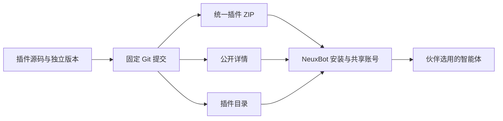
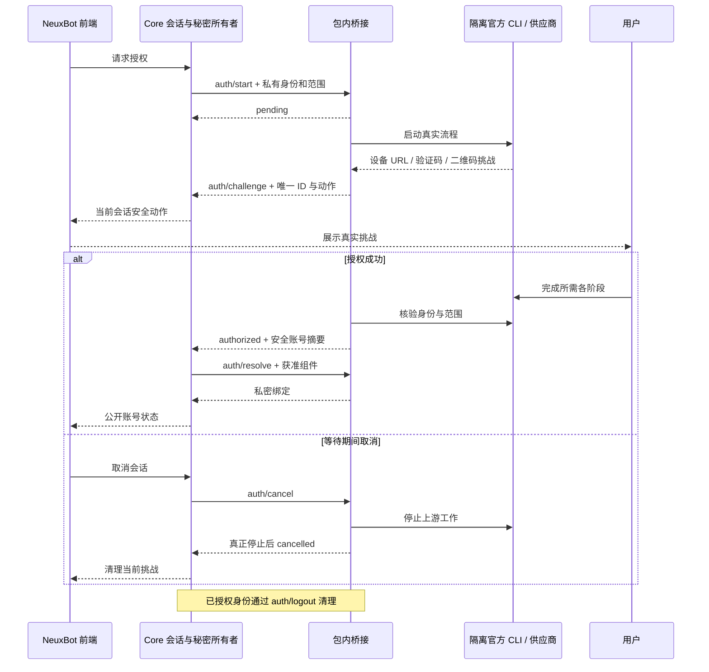

# Neux Plugins

[English](README.md) | [简体中文](README.zh-CN.md)

面向 NeuxBot 维护的 Agent Plugins 插件库。每个插件独立维护版本，并在包内声明使用的 MCP 服务、技能和授权方式。

## 插件目录

下面列出本仓库的 165 个源码包及清单版本。可安装版本以在线目录为准。 [在线目录](https://github.com/JieWaZi/neux-plugins/releases/latest/download/catalog.json) · [GitHub 发布记录](https://github.com/JieWaZi/neux-plugins/releases)

[效率工具](#效率工具) · [开发工具](#开发工具) · [数据与分析](#数据与分析) · [搜索与研究](#搜索与研究) · [设计](#设计) · [自动化](#自动化) · [文档](#文档) · [其他](#其他)

### 效率工具

| 插件 | 版本 | 业务能力 |
| --- | --- | --- |
| [Airtable](plugins/airtable/README.zh-CN.md) | `0.1.0` | 读取和更新 Airtable 记录，并查看数据表结构。 |
| [Akiflow](plugins/akiflow/README.zh-CN.md) | `0.1.0` | 结合 Akiflow 的任务和日历安排工作日程。 |
| [Ando](plugins/ando/README.zh-CN.md) | `0.1.0` | 在任务中使用 Ando 团队频道和讨论串中的上下文。 |
| [Atlassian](plugins/atlassian/README.zh-CN.md) | `0.1.0` | 通过 Atlassian Rovo 查找 Jira 工单和 Confluence 内容。 |
| [Attio](plugins/attio/README.zh-CN.md) | `0.1.0` | 在 Attio 工作区查找人员、公司和交易记录。 |
| [Basecamp](plugins/basecamp/README.zh-CN.md) | `0.1.0` | 查看 Basecamp 中的项目消息、待办事项和进度。 |
| [beehiiv](plugins/beehiiv/README.zh-CN.md) | `0.1.0` | 查看 beehiiv 刊物、通讯活动和受众数据。 |
| [Circleback](plugins/circleback/README.zh-CN.md) | `0.1.0` | 在 Circleback 中查找会议记录和后续事项。 |
| [ClickUp](plugins/clickup/README.zh-CN.md) | `0.1.0` | 查看 ClickUp 工作区中的任务和项目资料。 |
| [Cobrain](plugins/cobrain/README.zh-CN.md) | `0.1.0` | 从 Cobrain 的共享记忆中查找笔记和项目上下文。 |
| [Dart](plugins/dart/README.zh-CN.md) | `0.1.0` | 在 Dart 中处理项目任务和团队计划。 |
| [Eden](plugins/eden/README.zh-CN.md) | `0.1.0` | 在 Eden 中研究社交内容并查看发布活动。 |
| [Era](plugins/era/README.zh-CN.md) | `0.1.0` | 查看与 Era 关联的账户、交易和消费统计。 |
| [Fastmail](plugins/fastmail/README.zh-CN.md) | `0.1.0` | 在已授权的 Fastmail 邮件和日历中查找信息。 |
| [飞书](plugins/feishu-office/README.zh-CN.md) | `0.1.2` | 协助编写飞书文档、管理多维表格、安排日程和跟进任务。 |
| [Fellow](plugins/fellow/README.zh-CN.md) | `0.1.0` | 在 Fellow 中查找会议笔记、决策和安排。 |
| [Fireflies.ai](plugins/fireflies/README.zh-CN.md) | `0.1.0` | 检索 Fireflies 的会议转录并查看已记录的要点。 |
| [Granola](plugins/granola/README.zh-CN.md) | `0.1.0` | 查找 Granola 的会议笔记并回顾讨论中的决定。 |
| [Greenhouse](plugins/greenhouse/README.zh-CN.md) | `0.1.0` | 查看 Greenhouse 中的职位和招聘进展。 |
| [Help Scout](plugins/helpscout/README.zh-CN.md) | `0.1.0` | 在 Help Scout 中查找客户对话和邮箱活动。 |
| [HighLevel](plugins/highlevel/README.zh-CN.md) | `0.1.2` | 搜索 HighLevel 子账号的 CRM 记录、查看销售机会和日历。 |
| [Hindsight](plugins/hindsight/README.zh-CN.md) | `0.1.2` | 搜索并总结 Hindsight Cloud 各记忆库中的内容。 |
| [Honcho](plugins/honcho/README.zh-CN.md) | `0.1.2` | 查找过往对话的上下文，读取 Honcho 保存的人员和项目相关记忆。 |
| [Intercom](plugins/intercom/README.zh-CN.md) | `0.1.0` | 在 Intercom 中查找客户对话和支持记录。 |
| [Kajabi](plugins/kajabi/README.zh-CN.md) | `0.1.0` | 查看 Kajabi 中可访问的产品、内容和账户资料。 |
| [Klaviyo](plugins/klaviyo/README.zh-CN.md) | `0.1.0` | 查看 Klaviyo 账户中的受众和营销活动数据。 |
| [Knowify](plugins/knowify/README.zh-CN.md) | `0.1.0` | 查看 Knowify 中的施工任务和商业项目记录。 |
| [lemlist](plugins/lemlist/README.zh-CN.md) | `0.1.0` | 查看 lemlist 中的销售活动和潜在客户动态。 |
| [LMCP](plugins/localmcp/README.zh-CN.md) | `0.1.0` | 访问通过 LMCP 共享的本机应用。 |
| [MailerLite](plugins/mailerlite/README.zh-CN.md) | `0.1.0` | 查看 MailerLite 中的订阅者和邮件营销活动。 |
| [monday.com](plugins/monday/README.zh-CN.md) | `0.1.0` | 查看 monday.com 中的工作看板、条目和团队项目状态。 |
| [Notion](plugins/notion/README.zh-CN.md) | `0.1.2` | 搜索和管理 Notion 工作区中的页面和数据库。 |
| [Pipedrive](plugins/pipedrive/README.zh-CN.md) | `0.1.0` | 查看 Pipedrive 中的交易、联系人和销售管道进度。 |
| [Planning Center](plugins/planningcenter/README.zh-CN.md) | `0.1.0` | 查看 Planning Center 中可访问的人员和组织资源。 |
| [Plaud](plugins/plaud/README.zh-CN.md) | `0.1.0` | 查找 Plaud 中的录音、转录和会议记录。 |
| [Pylon](plugins/pylon/README.zh-CN.md) | `0.1.0` | 在 Pylon 中查找客户请求、账户和支持历史。 |
| [Quo](plugins/quo/README.zh-CN.md) | `0.1.0` | 在 Quo 中查看授权的商务通话、短信会话和联系人。 |
| [Raindrop.io](plugins/raindrop/README.zh-CN.md) | `0.1.0` | 检索和整理 Raindrop.io 收藏夹中的书签。 |
| [Resend](plugins/resend/README.zh-CN.md) | `0.1.0` | 在 API 密钥权限范围内查看投递情况并管理 Resend 邮件资源。 |
| [Roam Research](plugins/roam/README.zh-CN.md) | `0.1.0` | 检索 Roam Research 知识图中的笔记和相互关联的想法。 |
| [Spacefast](plugins/spacefast/README.zh-CN.md) | `0.1.0` | 查找 Spacefast 中可访问的托管页面和 Spaces。 |
| [Sunsama](plugins/sunsama/README.zh-CN.md) | `0.1.0` | 查看 Sunsama 中的每日计划、任务和日历信息。 |
| [Superhuman Mail](plugins/superhuman/README.zh-CN.md) | `0.1.0` | 在 Superhuman Mail 中查找邮件和相关会话。 |
| [Supermemory](plugins/supermemory/README.zh-CN.md) | `0.1.0` | 在 Supermemory 中查找已保存的信息并管理可用知识。 |
| [Todoist](plugins/todoist/README.zh-CN.md) | `0.1.0` | 查看 Todoist 账户中的项目和任务。 |
| [Trello](plugins/trello/README.zh-CN.md) | `0.1.0` | 查看 Trello 中可访问的看板、列表和卡片。 |
| [Typefully](plugins/typefully/README.zh-CN.md) | `0.1.0` | 在 Typefully 中查找社交内容草稿并查看排定的帖子。 |
| [企业微信](plugins/wecom-office/README.zh-CN.md) | `0.1.2` | 编写企业微信文档、管理表格、安排会议并跟进工作。 |

### 开发工具

| 插件 | 版本 | 业务能力 |
| --- | --- | --- |
| [1inch](plugins/1inch/README.zh-CN.md) | `0.1.2` | 查阅 1inch Business API 文档和 SDK 示例，查看公开的 Aqua 流动性分析。 |
| [21st](plugins/21st/README.zh-CN.md) | `0.1.0` | 查找网页项目可复用的界面组件和设计参考。 |
| [Algolia](plugins/algolia/README.zh-CN.md) | `0.1.0` | 查询账户有权访问的 Algolia 索引。 |
| [AppSignal](plugins/appsignal/README.zh-CN.md) | `0.1.0` | 通过 AppSignal 数据排查应用错误和性能问题。 |
| [AWS Knowledge](plugins/aws-knowledge/README.zh-CN.md) | `0.1.2` | 查询 AWS 官方文档，并按区域核实服务、API 与 CloudFormation 资源的可用性。 |
| [Base44](plugins/base44/README.zh-CN.md) | `0.1.0` | 访问 Base44 应用项目及工作区内可用的资源。 |
| [Better Stack](plugins/betterstack/README.zh-CN.md) | `0.1.0` | 查看 Better Stack 中的可观测数据和事件信息。 |
| [Buildkite](plugins/buildkite/README.zh-CN.md) | `0.1.0` | 查看 Buildkite 流水线、近期构建及作业结果。 |
| [Clerk](plugins/clerk/README.zh-CN.md) | `0.1.0` | 查看有权访问的 Clerk 项目中的用户和组织。 |
| [Cloudflare](plugins/cloudflare/README.zh-CN.md) | `0.1.0` | 查看 Cloudflare MCP 服务提供的账户资源。 |
| [Convex](plugins/convex/README.zh-CN.md) | `0.1.2` | 获取 Convex 新建应用、接入现有项目和后端扩容的开发指引。 |
| [DeepWiki](plugins/deepwiki/README.zh-CN.md) | `0.1.2` | 浏览公开 GitHub 仓库的生成式文档，并查询代码相关问题。 |
| [GitHub](plugins/github/README.zh-CN.md) | `0.1.2` | 检索 GitHub 仓库、议题和拉取请求，协助代码审查与协作。 |
| [Grafana Cloud](plugins/grafana/README.zh-CN.md) | `0.1.0` | 在 Grafana Cloud 中查看指标、日志和仪表板。 |
| [Hostinger](plugins/hostinger/README.zh-CN.md) | `0.1.0` | 查看 Hostinger 中可访问的网站和托管资源。 |
| [LaunchDarkly](plugins/launchdarkly/README.zh-CN.md) | `0.1.0` | 查看 LaunchDarkly 中的功能开关和环境配置。 |
| [Linear](plugins/linear/README.zh-CN.md) | `0.1.2` | 搜索 Linear 工作区的问题、查看项目并管理工作事项。 |
| [Lovable](plugins/lovable/README.zh-CN.md) | `0.1.0` | 查看 Lovable 工作区中可访问的应用项目。 |
| [Neon](plugins/neon/README.zh-CN.md) | `0.1.0` | 处理 Neon 中可访问的 Postgres 项目和分支。 |
| [Netlify](plugins/netlify/README.zh-CN.md) | `0.1.0` | 查看 Netlify 中的网站、部署和项目资源。 |
| [Postman](plugins/postman/README.zh-CN.md) | `0.1.0` | 查看 Postman 中的 API 集合、工作区和其他资源。 |
| [Prisma](plugins/prisma/README.zh-CN.md) | `0.1.0` | 查看 Prisma 中的数据库和项目资源。 |
| [Railway](plugins/railway/README.zh-CN.md) | `0.1.0` | 查看 Railway 项目、服务部署及其状态。 |
| [Render](plugins/render/README.zh-CN.md) | `0.1.2` | 检查 Render 工作区的服务、部署和运行日志。 |
| [Runpod](plugins/runpod/README.zh-CN.md) | `0.1.0` | 查看 Runpod 中可访问的云计算资源。 |
| [Sanity](plugins/sanity/README.zh-CN.md) | `0.1.0` | 查看 Sanity 项目和数据集中的结构化内容。 |
| [Sentry](plugins/sentry/README.zh-CN.md) | `0.1.0` | 在 Sentry 项目中排查错误和性能问题。 |
| [Statsig](plugins/statsig/README.zh-CN.md) | `0.1.0` | 查看 Statsig 中的功能门控和实验信息。 |
| [Svelte](plugins/svelte/README.zh-CN.md) | `0.1.2` | 查阅 Svelte 与 SvelteKit 文档、检查组件代码并生成 Svelte Playground 示例。 |
| [Twilio Docs](plugins/twilio-docs/README.zh-CN.md) | `0.1.2` | 检索 Twilio 公开开发文档，查阅 API 端点、参数及响应结构。 |
| [Wix](plugins/wix/README.zh-CN.md) | `0.1.0` | 处理 Wix 中可访问的网站和业务资源。 |
| [WorkOS](plugins/workos/README.zh-CN.md) | `0.1.0` | 查看 WorkOS 中可访问的身份和组织资源。 |

### 数据与分析

| 插件 | 版本 | 业务能力 |
| --- | --- | --- |
| [Aave](plugins/aave/README.zh-CN.md) | `0.1.2` | 查看 Aave V3 与 V4 的借贷市场、公开钱包仓位和治理信息。 |
| [Alpha Vantage](plugins/alphavantage/README.zh-CN.md) | `0.1.0` | 查找 Alpha Vantage 提供的金融时间序列和市场资料。 |
| [Amplitude](plugins/amplitude/README.zh-CN.md) | `0.1.0` | 在 Amplitude 中分析产品使用情况和用户行为。 |
| [Artie](plugins/artie/README.zh-CN.md) | `0.1.0` | 查看 Artie 中的数据库复制管道及其运行状态。 |
| [ClickHouse Cloud](plugins/clickhouse/README.zh-CN.md) | `0.1.0` | 探索 ClickHouse Cloud 中的数据库和查询资源。 |
| [Coinbase](plugins/coinbase/README.zh-CN.md) | `0.1.0` | 查找 Coinbase 的市场资料及账户可访问的记录。 |
| [CoinGecko](plugins/coingecko/README.zh-CN.md) | `0.1.2` | 从 CoinGecko 查询加密资产价格、历史行情和去中心化交易所的资金池数据。 |
| [Hex](plugins/hex/README.zh-CN.md) | `0.1.0` | 查看 Hex 工作区中可访问的项目、笔记本和分析。 |
| [IBKR](plugins/ibkr/README.zh-CN.md) | `0.1.0` | 查看盈透证券提供的账户和市场资料。 |
| [Kensho](plugins/kensho/README.zh-CN.md) | `0.1.0` | 查看 Kensho 账户可访问的金融研究和企业数据。 |
| [Massive](plugins/massive/README.zh-CN.md) | `0.1.0` | 查询 Massive 订阅可访问的市场数据。 |
| [Navan](plugins/navan/README.zh-CN.md) | `0.1.0` | 查看 Navan 中可访问的商务出行和费用记录。 |
| [PostHog](plugins/posthog/README.zh-CN.md) | `0.1.2` | 探索 PostHog 产品事件、检查功能开关并查询分析数据。 |
| [Ryze AI](plugins/ryze/README.zh-CN.md) | `0.1.0` | 查看与 Ryze AI 连接的广告账户及投放表现。 |
| [TradingView](plugins/tradingview/README.zh-CN.md) | `0.1.0` | 查找 TradingView 的市场资料用于研究。 |
| [Truthifi](plugins/truthifi/README.zh-CN.md) | `0.1.0` | 查看关联至 Truthifi 的投资账户资料。 |
| [Ubersuggest](plugins/ubersuggest/README.zh-CN.md) | `0.1.0` | 使用 Ubersuggest 数据研究搜索词和网站曝光度。 |
| [vidIQ](plugins/vidiq/README.zh-CN.md) | `0.1.0` | 查看 vidIQ 提供的视频、频道和选题研究资料。 |
| [Windsor.ai](plugins/windsor/README.zh-CN.md) | `0.1.0` | 查看通过 Windsor.ai 接入的营销和分析数据。 |

### 搜索与研究

| 插件 | 版本 | 业务能力 |
| --- | --- | --- |
| [Amplemarket](plugins/amplemarket/README.zh-CN.md) | `0.1.0` | 在 Amplemarket 中研究潜在客户并查看销售触达进展。 |
| [Apollo](plugins/apollo/README.zh-CN.md) | `0.1.0` | 在 Apollo 中查找企业、联系人和销售线索。 |
| [Brave Search](plugins/brave-search/README.zh-CN.md) | `0.1.0` | 使用 Brave Search 搜索公开网页、新闻、图片、视频及地点。 |
| [Bright Data](plugins/brightdata/README.zh-CN.md) | `0.1.0` | 通过 Bright Data 中已启用的服务获取公开网页数据。 |
| [Context7](plugins/context7/README.zh-CN.md) | `0.1.2` | 查找项目所用版本对应的库文档和代码示例。 |
| [DataForSEO](plugins/dataforseo/README.zh-CN.md) | `0.1.0` | 获取搜索排名、关键词数据以及相关 SEO 研究资料。 |
| [Dealroom](plugins/dealroom/README.zh-CN.md) | `0.1.0` | 通过 Dealroom 数据研究初创企业、投资人和融资动态。 |
| [Exa](plugins/exa/README.zh-CN.md) | `0.1.2` | 通过 Exa 搜索公开网页并提取正文。 |
| [Firecrawl](plugins/firecrawl/README.zh-CN.md) | `0.1.0` | 使用 Firecrawl 搜索公开网页并提取结构化内容。 |
| [Gojiberry](plugins/gojiberry/README.zh-CN.md) | `0.1.0` | 在 Gojiberry 中查找销售线索、查看拓客活动并回顾对话。 |
| [Harmonic](plugins/harmonic/README.zh-CN.md) | `0.1.0` | 使用 Harmonic 数据研究企业、人员和投资人。 |
| [Hugging Face](plugins/huggingface/README.zh-CN.md) | `0.1.2` | 发现 Hugging Face Hub 上的公开模型、数据集与 Spaces，并查看仓库元数据和文件。 |
| [Parallel](plugins/parallel/README.zh-CN.md) | `0.1.2` | 搜索公开网页、提取来源内容，并为具体决策整理证据。 |
| [Readwise](plugins/readwise/README.zh-CN.md) | `0.1.0` | 在 Readwise 中查找已保存的摘录和阅读资料。 |
| [Scrape Creators](plugins/scrapecreators/README.zh-CN.md) | `0.1.0` | 获取公开的创作者与社交内容数据用于研究。 |
| [SE Ranking](plugins/seranking/README.zh-CN.md) | `0.1.0` | 查看 SE Ranking 中的排名、网站及关键词研究资料。 |
| [Tavily](plugins/tavily/README.zh-CN.md) | `0.1.0` | 使用 Tavily 的搜索和提取能力研究公开网络资料。 |
| [You.com](plugins/you/README.zh-CN.md) | `0.1.0` | 通过 You.com 研究网络来源并查找相关资料。 |

### 设计

| 插件 | 版本 | 业务能力 |
| --- | --- | --- |
| [Canva](plugins/canva/README.zh-CN.md) | `0.1.0` | 查找 Canva 账户可访问的设计并使用相关素材。 |
| [Cloudinary](plugins/cloudinary/README.zh-CN.md) | `0.1.0` | 在 Cloudinary 的素材服务中查找和管理数字媒体。 |
| [Excalidraw](plugins/excalidraw/README.zh-CN.md) | `0.1.2` | 绘制手绘风格的示意图，并导出到 Excalidraw 继续编辑。 |
| [fal](plugins/fal/README.zh-CN.md) | `0.1.0` | 使用 fal 托管的媒体模型并查看生成结果。 |
| [Figma Desktop](plugins/figma/README.zh-CN.md) | `0.1.0` | 读取同一台电脑上 Figma Desktop 的设计信息。 |
| [Higgsfield](plugins/higgsfield/README.zh-CN.md) | `0.1.0` | 在 Higgsfield 中处理创意项目和媒体生成。 |
| [Magic Patterns](plugins/magicpatterns/README.zh-CN.md) | `0.1.0` | 在 Magic Patterns 中处理界面设计和原型。 |
| [Magnific](plugins/magnific/README.zh-CN.md) | `0.1.0` | 使用 Magnific 账户可访问的创意媒体工具。 |
| [Mobbin](plugins/mobbin/README.zh-CN.md) | `0.1.0` | 在 Mobbin 中查找界面示例和产品设计参考。 |
| [Mural](plugins/mural/README.zh-CN.md) | `0.1.0` | 在 Mural 中查找和使用视觉协作白板。 |
| [OpenArt](plugins/openart/README.zh-CN.md) | `0.1.0` | 在 OpenArt 中使用创意媒体项目和素材。 |
| [OpusClip](plugins/opusclip/README.zh-CN.md) | `0.1.0` | 查看 OpusClip 中的视频项目和短片。 |
| [Paper Desktop](plugins/paper/README.zh-CN.md) | `0.1.0` | 在同一台电脑上查看和编辑 Paper Desktop 当前打开的设计文件。 |
| [Picsart](plugins/picsart/README.zh-CN.md) | `0.1.0` | 使用 Picsart 提供的创意编辑和媒体生成服务。 |
| [Riverside](plugins/riverside/README.zh-CN.md) | `0.1.0` | 在 Riverside 中处理录制内容和媒体项目。 |
| [Runway](plugins/runway/README.zh-CN.md) | `0.1.0` | 在 Runway 创意工作区开展媒体生成相关工作。 |
| [Sunra](plugins/sunra/README.zh-CN.md) | `0.1.0` | 使用 Sunra 项目中可访问的媒体生成资源。 |
| [Webflow](plugins/webflow/README.zh-CN.md) | `0.1.0` | 查看 Webflow 账户中的网站和 CMS 内容。 |

### 自动化

| 插件 | 版本 | 业务能力 |
| --- | --- | --- |
| [AgentMail](plugins/agentmail/README.zh-CN.md) | `0.1.0` | 在工作中访问已授权的 AgentMail 邮箱和邮件会话。 |
| [Bird](plugins/bird/README.zh-CN.md) | `0.1.0` | 查看 Bird 中的消息及客户沟通记录。 |
| [Blotato](plugins/blotato/README.zh-CN.md) | `0.1.0` | 查看 Blotato 已连接的社交渠道并准备内容。 |
| [Browserless](plugins/browserless/README.zh-CN.md) | `0.1.0` | 使用 Browserless 开展浏览器任务和网页内容提取。 |
| [Buffer](plugins/buffer/README.zh-CN.md) | `0.1.0` | 查看 Buffer 中已连接的社交渠道和发布计划。 |
| [Composio](plugins/composio/README.zh-CN.md) | `0.1.2` | 通过 Composio Connect 查找并使用已连接应用的操作。 |
| [Customer.io](plugins/customerio/README.zh-CN.md) | `0.1.0` | 在 Customer.io 中查看客户档案和营销活动资料。 |
| [IFTTT](plugins/ifttt/README.zh-CN.md) | `0.1.0` | 查看 IFTTT 中已连接的服务和可用的自动化流程。 |
| [Postiz](plugins/postiz/README.zh-CN.md) | `0.1.2` | 查看 Postiz 已连接的社交渠道，并管理排期中的帖子。 |
| [Speko](plugins/speko/README.zh-CN.md) | `0.1.0` | 查看 Speko 中的语音智能体及相关通话记录。 |
| [TinyFish](plugins/tinyfish/README.zh-CN.md) | `0.1.0` | 通过 TinyFish 开展支持的浏览器研究和网页自动化任务。 |
| [TryPost](plugins/trypost/README.zh-CN.md) | `0.1.0` | 查看 TryPost 已连接的社交渠道并制定发布计划。 |
| [Zapier](plugins/zapier/README.zh-CN.md) | `0.1.0` | 使用在 Zapier 中配置的已连接应用能力。 |

### 文档

| 插件 | 版本 | 业务能力 |
| --- | --- | --- |
| [Craft](plugins/craft/README.zh-CN.md) | `0.1.0` | 在 Craft 空间中查找和处理文档。 |
| [Guru](plugins/guru/README.zh-CN.md) | `0.1.0` | 检索 Guru 工作区内可访问的已验证知识。 |
| [PandaDoc](plugins/pandadoc/README.zh-CN.md) | `0.1.0` | 查找 PandaDoc 中可访问的提案、合同及其他文档。 |

### 其他

| 插件 | 版本 | 业务能力 |
| --- | --- | --- |
| [Airwallex](plugins/airwallex/README.zh-CN.md) | `0.1.0` | 查看 Airwallex 账户中可访问的余额、付款活动及相关记录。 |
| [DeepLedger](plugins/deepledger/README.zh-CN.md) | `0.1.0` | 查看已连接到 DeepLedger 的会计记录。 |
| [Extend](plugins/extend/README.zh-CN.md) | `0.1.0` | 查看 Extend 中可访问的虚拟卡及支出活动。 |
| [Fanvue](plugins/fanvue/README.zh-CN.md) | `0.1.0` | 查看和处理 Fanvue 中可访问的创作者账户资料。 |
| [freee](plugins/freee/README.zh-CN.md) | `0.1.0` | 查看 freee 组织中可访问的会计记录。 |
| [GoDaddy](plugins/godaddy/README.zh-CN.md) | `0.1.2` | 通过 GoDaddy 获取域名建议并查询公开的可注册状态。 |
| [Mercury](plugins/mercury/README.zh-CN.md) | `0.1.0` | 查看 Mercury 中的银行账户活动和交易记录。 |
| [Monarch](plugins/monarch/README.zh-CN.md) | `0.1.0` | 查看 Monarch 中的个人账户活动和预算。 |
| [RevenueCat](plugins/revenuecat/README.zh-CN.md) | `0.1.2` | 查看 RevenueCat 项目的订阅商品、套餐和订阅权益。 |
| [Square](plugins/square/README.zh-CN.md) | `0.1.0` | 查看 Square 中可访问的商户、付款和订单信息。 |
| [Stripe](plugins/stripe/README.zh-CN.md) | `0.1.0` | 查看 Stripe 账户可访问的付款和账单资源。 |
| [Tessie](plugins/tessie/README.zh-CN.md) | `0.1.2` | 通过 Tessie 查看车辆状态、电池电量及近期充电记录。 |
| [Wellness Project](plugins/wellnessproject/README.zh-CN.md) | `0.1.0` | 查看 Wellness Project 中的健身、营养和其他健康记录。 |
| [Whop](plugins/whop/README.zh-CN.md) | `0.1.0` | 查看 Whop 账户中可访问的产品和社区资源。 |

## 仓库结构

- `plugins/` 保存各插件的统一包，包含介绍能力和接入要求的中英文说明。
- `patches/` 保存供应商隔离补丁、回归源码、原始许可与来源记录。
- `scripts/` 保存目录、插件归档及固定源码供应商程序的构建脚本。

NeuxBot 从 HTTP 目录读取插件，核验统一归档后将固定版本安装到伙伴。配置与账号生命周期归 NeuxBot 管理，宿主从同一包完成所选智能体的交付。

清单 `repository` 与 `extensions.com.openai.interface.developerName` 指向官方业务能力项目和品牌：GitHub / `github/github-mcp-server`，飞书 / `larksuite/cli`。`author` 如实说明包内封装与桥接由 NeuxBot contributors 编写；统一 `provenance.upstream` 记录插件信息面板读取的实际业务能力作者、版本、许可与仓库。官方服务或技能作者不等同本封装作者，品牌署名也不代表官方背书。见[第三方声明](THIRD_PARTY_NOTICES.md)。



## 维护标准包

在 `plugins/<key>/plugin.json` 中定义 Agent Plugins 1.0.0 清单、身份、独立版本、描述、真实作者与许可。Skills 放在 `skills/`，MCP 声明放在 `mcp.json`。保留第三方源码、脚本、相对引用和执行位，并在[来源规范](docs/PROVENANCE.zh-CN.md)中记录许可与改动。统一包中每个组件只定义一次。

各插件中英文 README 只介绍插件自身能力、权限前提和实用场景，不写宿主角色、安装流程、聊天引导或语言导航，由宿主按系统语言读取。默认英文展示字段、可选本地化文字和静态 PNG 遵守[展示维护指南](docs/MAINTAINING.zh-CN.md)。没有 `.neuxbot/` 仍是标准包。

## 声明驱动授权

MCP 服务与技能仍由标准文件定义；可选根清单 `extensions.com.neuxbot.authentication` 只增加宿主集成：认证策略、权限、首选挑战动作和精确授权绑定，不重复身份或组件列表。

需要交互式授权桥接的包使用 `extensions.com.neuxbot.authentication.strategy: plugin-command`、`protocol: neuxbot-auth/1`、受信 Node 与包内桥接入口。前端只显示 Core 交付的安全动作并发送取消请求；可选[挑战提示](docs/AUTH-CHALLENGE-NOTICES.zh-CN.md)由包内声明，只作用于当前挑战，宿主采用固定警告样式；Core 管理会话、占用和私密执行绑定；桥接解释供应商流程。供应商原始帧、凭据和私密绑定不进入前端。

使用 API 密钥的插件通过 `extensions.com.neuxbot.configuration` 声明必填密钥。Gojiberry 等托管服务将密钥绑定到指定 MCP 请求头，Brave Search 则通过环境变量把密钥交给包内 stdio 程序。Figma Desktop 和 Paper Desktop 连接本机应用的回环 MCP 服务。

- GitHub 通过固定隔离 CLI 执行官方设备 OAuth，发出真实 `https://github.com/login/device` 地址和一次性验证码，在线核验账号与授权范围，只为精确 `github` MCP `https://api.githubcopilot.com/mcp/` 交付私密 OAuth Bearer 头。授权按精确组件声明并由所有支持的 CLI 目标共享；真实目标差异才显式指定 runtime；不包含 PAT 占位配置或托管 app 连接。`preferredAction: open-url` 不代表支持二维码。
- 飞书按官方顺序发出创建应用与用户授权的两次二维码挑战。已有应用配置但尚无用户身份是合法待授权阶段，只有最终在线核验身份与范围后才可用。`preferredAction: show-qr` 允许前端等待真实挑战时准备二维码占位。精确协议见[飞书桥接](plugins/feishu-office/.neuxbot/auth/README.md)与[GitHub 桥接](plugins/github/.neuxbot/auth/README.md)。



供应商程序下载、完整性校验或依赖准备失败通过 `dependency_unavailable` 返回；实际登录与账号核验失败仍使用 `authorization_failed`。宿主按失败阶段提示，不能把未核验账号或依赖失败标记为授权成功。

供应商程序是独立、摘要锁定的依赖，由插件下载到私有数据目录；宿主不为每个提供者内置下载或打包分支。包内锁固定 HTTPS URL、大小、摘要、源码、工具链及隔离证据。GitHub 清空继承的 CLI 凭据、使用私有 profile，其底层钥匙串服务绑定规范目录摘要。飞书保持既有私有配置和凭据隔离。测试受信覆盖可提供同一程序边界，不查找用户全局 CLI。

企业微信固定官方 CLI `1.3.4` 发布提交与五平台 npm 归档及程序摘要，首次使用下载到插件私有目录，不进行全局 npm 安装。官方 CLI 生成 PNG 二维码并完成扫码协议；桥接将原始图片交给通用 `show-qr` 动作，通过 `auth show` 和线上 `identity whoami` 核验身份。当前官方 CLI 没有独立 MCP server 子命令，本包交付官方 CLI 与 Skills，不声明旧版 MCP 端点。共享技能只调整程序安装和认证入口，其他官方资料保留原文，见[企业微信桥接](plugins/wecom-office/.neuxbot/auth/README.md)。

本包需要支持 PNG 二维码挑战和多个受管 CLI 路径合并的 NeuxBot 宿主。旧版宿主需要先更新，不能将 PNG data URL 再编码成二维码。官方没有 Windows ARM64 平台包，该平台准确返回程序未就绪。

## HTTP 目录与完整快照

插件详情与 SKILL 正文通过摘要绑定的[只读资料侧车](docs/DETAILS.zh-CN.md)提供，不要求先安装到伙伴或授权账号，也不需要下载完整安装 ZIP。

[插件目录](https://github.com/JieWaZi/neux-plugins/releases/latest/download/catalog.json)为每个已发布插件保留一个稳定版本，包含托管 OAuth 插件。目录使用 `schemaVersion: 1`。每项独立绑定来源提交、包路径、归档地址及摘要，以及固定详情地址、大小和摘要。

ZIP 包含完整标准包、来源和许可证据，以及所选插件使用的供应商补丁。安装与日常目录构建直接读取完整包。独立业务服务和首次获取供应商依赖仍需联网。客户端解包前核对归档摘要。

## 独立发布插件

1. 在 `plugins/<key>/plugin.json` 中提升受影响插件的稳定 SemVer，并将改动合入 `main`。保留包的 key 和 name。例如 GitHub 可从已有的 `0.1.1` 升到 `0.1.2`。共享输入影响多个插件时，分别为受影响的插件升版和发布。
2. 将 `<key>@<version>` 标签指向合入后的提交，再推送标签，例如 `github@0.1.2`。发布维护者从受保护的 `main` 手动运行 **Release plugin**，将插件标签作为输入。各任务运行该次 `main` 提交中的已审查脚本。构建任务核对标签提交与 Manifest，发布任务将统一 ZIP、公开详情和单条目录上传到固定标签，Latest 继续指向全量目录。
3. 目录任务读取当时的 Latest，更新对应插件条目，再将完整的 `catalog.json` 发布为 Latest。失败后重跑工作流的失败任务。工作流复用摘要一致的资产，遇到同版本不同绑定会报错，遇到目录中的更高版本会保留当前条目。

保留已发布的标签、资产以及包内锁引用的供应商程序和许可文件。仓库权限配置、发布命令及重试规则见[发布指南](docs/RELEASING.md)。

## 本地构建与测试

使用 Node 22+ 和 Git。构建命令读取已提交的快照，并在本地生成产物。

```sh
npm ci
npm test
node scripts/build-catalog.mjs HEAD v0.1.2-dev
```

在提交清单版本 `0.1.2` 后，运行 `npm run build:release -- HEAD github@0.1.2 /absolute/path/to/output` 构建 GitHub 插件。输出只有 `catalog.json`、`github.zip` 和 `github.details.json`。发布构建使用 Node 22+ 与 Git。

portable 构建器核验标准包、来源、依赖锁与本地资产摘要，再替换输出。全量开发构建保留 `dist/providers`。单插件演练请指定独立输出目录。

供应商重构建是独立且明确的操作，不是目录构建前置：

```sh
node scripts/build-github-provider.mjs
node scripts/build-lark-provider.mjs
```

固定源码构建核验来源和隔离行为，完成六平台交叉编译，并收集依赖许可原文。GitHub 和飞书使用专用 `v0.1.4-providers` Release 中的固定供应商资产。迁移已核验的程序和许可时，先生成新的锁定地址，在该地址发布资产，再为依赖它们的插件打标签。上游版本和作者来自 `provenance.upstream`。具体步骤见[发布指南](docs/RELEASING.md)。

根 [MIT 许可](LICENSE)覆盖 NeuxBot 自编封装；第三方内容和品牌资产保留实际条款与如实披露的许可缺口。
