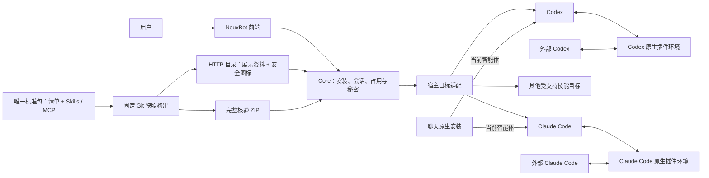
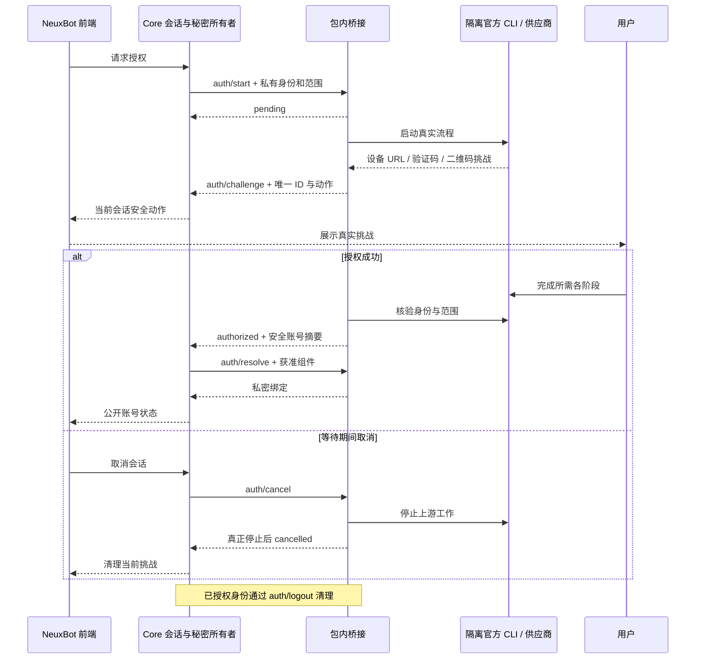

# Neux Plugins

[English](README.md) | [简体中文](README.zh-CN.md)

自行维护的 OpenAI/Codex 标准插件库，提供 GitHub 代码审查与协作，以及飞书、企业微信文档、表格、日程和任务能力。每项只维护 `plugins/` 下的一套完整标准包。

| 插件 | 业务能力 |
| --- | --- |
| [GitHub](plugins/github/README.zh-CN.md) | 检索仓库代码、跟进议题和拉取请求、检查变更及构建结果 |
| [飞书办公](plugins/feishu-office/README.zh-CN.md) | 创建和整理文档、管理表格记录、安排日程并跟进任务 |
| [企业微信办公](plugins/wecom-office/README.zh-CN.md) | 管理文档与表格、安排会议、跟进待办及处理邮件和文件 |

仓库根是插件库和 marketplace，不是单个插件，因此没有根级单插件 `plugin.json`。各包拥有自己的标准身份与组件。同一能力只维护一份定义，由宿主适配目标格式，不分别收集 Codex 和 Claude 实现。

## 标准包与宿主适配

- `plugins/github/`：一份标准清单、一项官方 GitHub MCP 声明、业务说明、品牌资产和包内设备授权。
- `plugins/feishu-office/`：一份标准清单、完整官方技能及相对资料、业务说明、品牌资产和包内授权。
- `plugins/wecom-office/`：一份标准清单、15 项固定版本官方技能及引用资料、双语说明和包内二维码授权。
- `.agents/plugins/marketplace.json`：指向实际标准包的本地入口；不另维护 Claude marketplace 或仅包含来源描述的原生引用目录。
- `patches/`：供应商隔离补丁、回归源码、原始许可与来源记录。
- `scripts/`：确定性目录/ZIP 构建和独立固定源码程序构建；忽略的 `dist/` 保存发布资产，`.cache/` 保存核验后的构建输入。

NeuxBot 只通过本库发布的 HTTP 目录为伙伴安装插件，并将同一个标准包适配到所选智能体。系统不提供上传、本地目录或 ZIP 导入，也不收集和管理用户原生 CLI 的第三方插件。用户在聊天中要求安装原生插件时，由当前 Codex 或 Claude Code 使用与外部相同 CLI 共用的原生插件环境处理；这类安装、启停和认证归 CLI 管理，不登记为 NeuxBot 资源。直接标准使用可读取根本地 marketplace 或包内标准内容，具体能力与授权方式以 CLI 支持范围为准；Codex 不会自动解释 NeuxBot 专属授权声明。

清单 `repository` 与 `interface.developerName` 指向官方业务能力项目和品牌：GitHub / `github/github-mcp-server`，飞书 / `larksuite/cli`。`author` 如实说明包内封装与桥接由 NeuxBot contributors 编写；统一 `provenance.upstream` 记录插件信息面板读取的实际业务能力作者、版本、许可与仓库。官方服务或技能作者不等同本封装作者，品牌署名也不代表官方背书。见[第三方声明](THIRD_PARTY_NOTICES.md)。



## 维护标准包

在 `plugins/<key>/.codex-plugin/plugin.json` 定义标准身份、版本、描述及真实作者与许可。按[官方打包字段](https://developers.openai.com/plugins/build/plugins)声明真实 Skills 和 MCP，保留第三方源码、脚本、相对引用与执行位。将审核后所需上游内容复制到包内并本地维护，在[统一来源规范](docs/PROVENANCE.zh-CN.md)中说明真实许可及改动。不增加手工维护的第二份组件索引或原生来源引用清单。

各插件中英文 README 只介绍插件自身能力、权限前提和实用场景，不写宿主角色、安装流程、聊天引导或语言导航，由宿主按系统语言读取。默认英文展示字段、可选本地化文字和静态 PNG 遵守[展示维护指南](docs/MAINTAINING.zh-CN.md)。没有 `.neuxally/` 仍是标准包。

## 声明驱动授权

MCP 服务与技能仍由标准文件定义；可选 `.neuxally/integration.json` 只增加宿主集成：认证策略、权限、首选挑战动作和精确授权绑定，不重复身份或组件列表。

需要授权的包均采用 `authentication.strategy: plugin-command`、`protocol: neuxally-auth/1`、受信 Node 与包内桥接入口。前端只显示 Core 交付的安全动作并发送取消请求；可选[挑战提示](docs/AUTH-CHALLENGE-NOTICES.zh-CN.md)由包内声明，只作用于当前挑战，宿主采用固定警告样式；Core 管理会话、占用和私密执行绑定；桥接解释供应商流程。供应商原始帧、凭据和私密绑定不进入前端。

- GitHub 通过固定隔离 CLI 执行官方设备 OAuth，发出真实 `https://github.com/login/device` 地址和一次性验证码，在线核验账号与授权范围，只为精确 `github` MCP `https://api.githubcopilot.com/mcp/` 交付私密 OAuth Bearer 头。OAuth 只对明确声明的 Codex 和 Claude 目标绑定同一组件，其他运行目标不能回退到未声明授权路径；不包含 PAT 占位配置或托管 app 连接。`preferredAction: open-url` 不代表支持二维码。
- 飞书按官方顺序发出创建应用与用户授权的两次二维码挑战。已有应用配置但尚无用户身份是合法待授权阶段，只有最终在线核验身份与范围后才可用。`preferredAction: show-qr` 允许前端等待真实挑战时准备二维码占位。精确协议见[飞书桥接](plugins/feishu-office/.neuxally/auth/README.md)与[GitHub 桥接](plugins/github/.neuxally/auth/README.md)。



供应商程序是独立、摘要锁定的依赖，由插件下载到私有数据目录；宿主不为每个提供者内置下载或打包分支。包内锁固定 HTTPS URL、大小、摘要、源码、工具链及隔离证据。GitHub 清空继承的 CLI 凭据、使用私有 profile，其底层钥匙串服务绑定规范目录摘要。飞书保持既有私有配置和凭据隔离。测试受信覆盖可提供同一程序边界，不查找用户全局 CLI。

企业微信固定官方 CLI `1.3.4` 发布提交与五平台 npm 归档及程序摘要，首次使用下载到插件私有目录，不进行全局 npm 安装。官方 CLI 生成 PNG 二维码并完成扫码协议；桥接将原始图片交给通用 `show-qr` 动作，通过 `auth show` 和线上 `identity whoami` 核验身份。当前官方 CLI 没有独立 MCP server 子命令，本包交付官方 CLI 与 Skills，不声明旧版 MCP 端点。共享技能只调整程序安装和认证入口，其他官方资料保留原文，见[企业微信桥接](plugins/wecom-office/.neuxally/auth/README.md)。

本包需要支持 PNG 二维码挑战和多个受管 CLI 路径合并的 NeuxBot 宿主。旧版宿主需要先更新，不能将 PNG data URL 再编码成二维码。官方没有 Windows ARM64 平台包，该平台准确返回程序未就绪。

## HTTP 目录与完整快照

插件详情与 SKILL 正文通过摘要绑定的[只读资料侧车](docs/DETAILS.zh-CN.md)提供，不要求先安装到伙伴或授权账号，也不需要下载完整安装 ZIP。

使用[最新目录](https://github.com/JieWaZi/neux-plugins/releases/latest/download/catalog.json)或[固定 v0.1.0 目录](https://github.com/JieWaZi/neux-plugins/releases/download/v0.1.0/catalog.json)。`{schemaVersion:2,entries:[...]}` 每项记录 `key`、完整 `sourceCommit`、`archiveURL`、`archiveSHA256`、`packagePath: plugins/<key>`、标准 `name`、`version`、英文 `description` 和 `format: codex`。可选本地化文字与安全内嵌图标支持安装前展示，组件组成从真实包读取。

ZIP 包含完整标准包、本地 Codex 索引、来源/许可证据与公开补丁。安装与日常目录构建均不依赖上游 Git 或 HTTP 还原。独立业务服务和首次供应商依赖仍需联网。客户端解包前核对目录所选归档摘要；测试发布资产变更时，已安装快照仍由原来源提交和摘要固定。

## 构建与测试发布

使用 Node 22+ 和 Git 构建已提交快照，工作区脏文件与时间不进入产物：

```sh
npm ci
npm test
node scripts/build-catalog.mjs HEAD v0.1.0
```

构建器核验标准包、统一来源 schema、依赖锁与本地资产摘要，生成确定性 ZIP 与目录，校验完成后替换输出。CLI 会替换 `dist` 输出目录并保留 `dist/providers`；需要保留其他无关回执时，使用导出的 `buildCatalog({root,out,sourceCommit})` 指定独立输出目录。

供应商重构建是独立且明确的操作，不是目录构建前置：

```sh
node scripts/build-github-provider.mjs
node scripts/build-lark-provider.mjs
```

固定源码构建核验归档与隔离测试，完成六平台交叉编译，并收集真实依赖许可原文。既有供应商依赖锁继续引用已核验的 `v0.1.0` 资产；发布包元数据和图标不重构建这些依赖。协议/schema 版本与内部包身份含义独立；当前内部包／测试发布身份仍是 `0.1.0` / `v0.1.0`。面向用户的版本与作者直接读取 `provenance.upstream`，飞书显示 `v1.0.98`，未固定的托管 MCP 不声明服务版本。固定引用表示核验过的输入，不代表所有依赖均为上游最新版本。

明确获准后，可用核验后的新快照替换固定测试标签及对应资产。先发布需要的供应商二进制与许可，再发布目录/ZIP，最后经 HTTP 同时核对标签指向、sourceCommit 和所有资产摘要。不能静默替换已有安装快照。自动化测试、交叉编译和发布不代替真实账号、平台、智能体或界面验收。

根 [MIT 许可](LICENSE)覆盖 NeuxBot 自编封装；第三方内容和品牌资产保留实际条款与如实披露的许可缺口。
