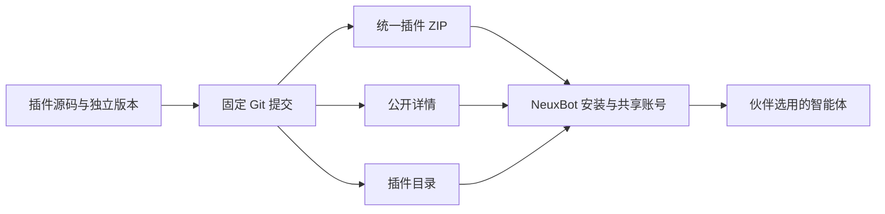
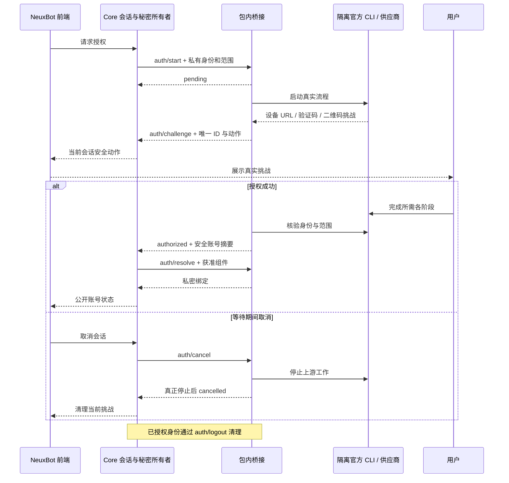

# Neux Plugins

[English](README.md) | [简体中文](README.zh-CN.md)

面向 NeuxBot 维护的插件库，涵盖办公协作、开发工具、搜索、数据分析及其他托管 MCP 服务。每个插件在 `plugins/` 下维护一份完整 Agent Plugins 标准包和自己的版本号。

| 插件 | 业务能力 |
| --- | --- |
| [GitHub](plugins/github/README.zh-CN.md) | 检索仓库代码、跟进议题和拉取请求、检查变更及构建结果 |
| [飞书办公](plugins/feishu-office/README.zh-CN.md) | 创建和整理文档、管理表格记录、安排日程并跟进任务 |
| [企业微信办公](plugins/wecom-office/README.zh-CN.md) | 管理文档与表格、安排会议、跟进待办及处理邮件和文件 |

每个插件维护自己的清单与版本，并声明所使用的 MCP 服务、技能和授权方式。NeuxBot 负责安装、更新、共享账号及所选智能体的交付。本仓库按插件发布统一包。

## 插件源码

- `plugins/github/`：一份标准清单、一项官方 GitHub MCP 声明、业务说明、品牌资产和包内设备授权。
- `plugins/feishu-office/`：一份标准清单、完整官方技能及相对资料、业务说明、品牌资产和包内授权。
- `plugins/wecom-office/`：一份标准清单、15 项固定版本官方技能及引用资料、双语说明和包内二维码授权。
- [plugins/](plugins/) 下的其余目录包含托管和本机 MCP 插件及中英文说明。厂商账号、API 密钥及桌面应用等前提见各插件 README。
- `patches/`：供应商隔离补丁、回归源码、原始许可与来源记录。
- `scripts/`：确定性目录/ZIP 构建和独立固定源码程序构建；忽略的 `dist/` 保存发布资产，`.cache/` 保存核验后的构建输入。

NeuxBot 从 HTTP 目录读取插件，核验统一归档后将固定版本安装到伙伴。配置与账号生命周期归 NeuxBot 管理，宿主从同一包完成所选智能体的交付。

清单 `repository` 与 `extensions.com.openai.interface.developerName` 指向官方业务能力项目和品牌：GitHub / `github/github-mcp-server`，飞书 / `larksuite/cli`。`author` 如实说明包内封装与桥接由 NeuxBot contributors 编写；统一 `provenance.upstream` 记录插件信息面板读取的实际业务能力作者、版本、许可与仓库。官方服务或技能作者不等同本封装作者，品牌署名也不代表官方背书。见[第三方声明](THIRD_PARTY_NOTICES.md)。



## 维护标准包

在 `plugins/<key>/plugin.json` 中定义 Agent Plugins 1.0.0 清单、身份、独立版本、描述、真实作者与许可。Skills 放在 `skills/`，MCP 声明放在 `mcp.json`。保留第三方源码、脚本、相对引用和执行位，并在[来源规范](docs/PROVENANCE.zh-CN.md)中记录许可与改动。统一包中每个组件只定义一次。

各插件中英文 README 只介绍插件自身能力、权限前提和实用场景，不写宿主角色、安装流程、聊天引导或语言导航，由宿主按系统语言读取。默认英文展示字段、可选本地化文字和静态 PNG 遵守[展示维护指南](docs/MAINTAINING.zh-CN.md)。没有 `.neuxbot/` 仍是标准包。

## 声明驱动授权

MCP 服务与技能仍由标准文件定义；可选根清单 `extensions.com.neuxbot.authentication` 只增加宿主集成：认证策略、权限、首选挑战动作和精确授权绑定，不重复身份或组件列表。

需要交互式授权桥接的包使用 `extensions.com.neuxbot.authentication.strategy: plugin-command`、`protocol: neuxbot-auth/1`、受信 Node 与包内桥接入口。前端只显示 Core 交付的安全动作并发送取消请求；可选[挑战提示](docs/AUTH-CHALLENGE-NOTICES.zh-CN.md)由包内声明，只作用于当前挑战，宿主采用固定警告样式；Core 管理会话、占用和私密执行绑定；桥接解释供应商流程。供应商原始帧、凭据和私密绑定不进入前端。

使用 API 密钥的插件通过 `extensions.com.neuxbot.configuration` 声明必填密钥。Gojiberry 等托管服务将密钥绑定到指定 MCP 请求头，Brave Search 则通过环境变量把密钥交给包内 stdio 程序。Figma Desktop 和 Paper Desktop 连接本机应用的回环 MCP 服务。

- GitHub 通过固定隔离 CLI 执行官方设备 OAuth，发出真实 `https://github.com/login/device` 地址和一次性验证码，在线核验账号与授权范围，只为精确 `github` MCP `https://api.githubcopilot.com/mcp/` 交付私密 OAuth Bearer 头。授权按精确组件声明并由所有支持的 CLI 目标共享；真实目标差异才显式指定 runtime；不包含 PAT 占位配置或托管 app 连接。`preferredAction: open-url` 不代表支持二维码。
- 飞书按官方顺序发出创建应用与用户授权的两次二维码挑战。已有应用配置但尚无用户身份是合法待授权阶段，只有最终在线核验身份与范围后才可用。`preferredAction: show-qr` 允许前端等待真实挑战时准备二维码占位。精确协议见[飞书桥接](plugins/feishu-office/.neuxbot/auth/README.md)与[GitHub 桥接](plugins/github/.neuxbot/auth/README.md)。



供应商程序下载、完整性校验或依赖准备失败通过 `dependency_unavailable` 返回；实际登录与账号核验失败仍使用 `authorization_failed`。宿主按失败阶段提示，不能把未核验账号或依赖失败标记为授权成功。

供应商程序是独立、摘要锁定的依赖，由插件下载到私有数据目录；宿主不为每个提供者内置下载或打包分支。包内锁固定 HTTPS URL、大小、摘要、源码、工具链及隔离证据。GitHub 清空继承的 CLI 凭据、使用私有 profile，其底层钥匙串服务绑定规范目录摘要。飞书保持既有私有配置和凭据隔离。测试受信覆盖可提供同一程序边界，不查找用户全局 CLI。

企业微信固定官方 CLI `1.3.4` 发布提交与五平台 npm 归档及程序摘要，首次使用下载到插件私有目录，不进行全局 npm 安装。官方 CLI 生成 PNG 二维码并完成扫码协议；桥接将原始图片交给通用 `show-qr` 动作，通过 `auth show` 和线上 `identity whoami` 核验身份。当前官方 CLI 没有独立 MCP server 子命令，本包交付官方 CLI 与 Skills，不声明旧版 MCP 端点。共享技能只调整程序安装和认证入口，其他官方资料保留原文，见[企业微信桥接](plugins/wecom-office/.neuxbot/auth/README.md)。

本包需要支持 PNG 二维码挑战和多个受管 CLI 路径合并的 NeuxBot 宿主。旧版宿主需要先更新，不能将 PNG data URL 再编码成二维码。官方没有 Windows ARM64 平台包，该平台准确返回程序未就绪。

## HTTP 目录与完整快照

插件详情与 SKILL 正文通过摘要绑定的[只读资料侧车](docs/DETAILS.zh-CN.md)提供，不要求先安装到伙伴或授权账号，也不需要下载完整安装 ZIP。

[插件目录](https://github.com/JieWaZi/neux-plugins/releases/latest/download/catalog.json)为每个已发布插件保留一个稳定版本，包含托管 OAuth 插件。目录使用 `schemaVersion: 1`。每项独立绑定来源提交、包路径、归档地址及摘要，以及固定详情地址、大小和摘要。

ZIP 包含完整标准包、来源和许可证据，以及所选插件使用的供应商补丁。安装与日常目录构建直接读取完整包。独立业务服务和首次获取供应商依赖仍需联网。客户端解包前核对归档摘要。

## 独立发布插件

1. 在 `plugins/<key>/plugin.json` 中提升受影响插件的稳定 SemVer，并将改动合入 `main`。保留包的 key 和 name。例如 GitHub 可从已有的 `0.1.1` 升到 `0.1.2`。共享输入影响多个插件时，分别为受影响的插件升版和发布。
2. 将 `<key>@<version>` 标签指向合入后的提交，再推送标签，例如 `github@0.1.2`。发布维护者从受保护的 `main` 手动运行 **Release plugin**，将插件标签作为输入。各任务运行该次 `main` 提交中的已审查脚本。构建任务核对标签提交与 Manifest，发布任务将统一 ZIP、公开详情和单条目录上传到固定标签，Latest 继续指向全量目录。
3. 目录任务读取当时的 Latest，更新对应插件条目，再将完整的 `catalog.json` 发布为 Latest。失败后重跑工作流的失败任务。工作流复用摘要一致的资产，遇到同版本不同绑定会报错，遇到目录中的更高版本会保留当前条目。

保留已发布的标签、资产以及包内锁引用的供应商程序和许可文件。仓库权限配置、发布命令及重试规则见[发布指南](docs/RELEASING.md)。

## 本地构建与测试

使用 Node 22+ 和 Git。构建命令读取已提交的快照，并在本地生成产物。

```sh
npm ci
npm test
node scripts/build-catalog.mjs HEAD v0.1.2-dev
```

在提交清单版本 `0.1.2` 后，运行 `npm run build:release -- HEAD github@0.1.2 /absolute/path/to/output` 构建 GitHub 插件。输出只有 `catalog.json`、`github.zip` 和 `github.details.json`。发布构建使用 Node 22+ 与 Git。

portable 构建器核验标准包、来源、依赖锁与本地资产摘要，再替换输出。全量开发构建保留 `dist/providers`。单插件演练请指定独立输出目录。

供应商重构建是独立且明确的操作，不是目录构建前置：

```sh
node scripts/build-github-provider.mjs
node scripts/build-lark-provider.mjs
```

固定源码构建核验来源和隔离行为，完成六平台交叉编译，并收集依赖许可原文。GitHub 和飞书使用专用 `v0.1.4-providers` Release 中的固定供应商资产。迁移已核验的程序和许可时，先生成新的锁定地址，在该地址发布资产，再为依赖它们的插件打标签。上游版本和作者来自 `provenance.upstream`。具体步骤见[发布指南](docs/RELEASING.md)。

根 [MIT 许可](LICENSE)覆盖 NeuxBot 自编封装；第三方内容和品牌资产保留实际条款与如实披露的许可缺口。
