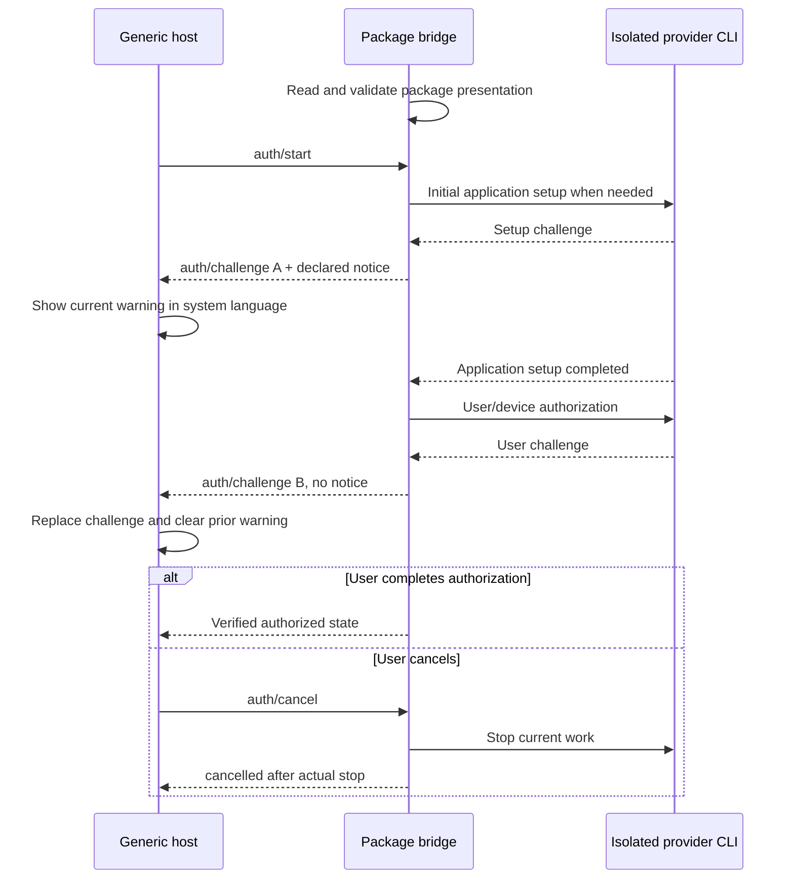

# Package-declared authorization challenge notices

[English](AUTH-CHALLENGE-NOTICES.md) | [简体中文](AUTH-CHALLENGE-NOTICES.zh-CN.md)

An authorization challenge may carry a temporary warning for its current step. The package declares the wording and its bridge selects the step; NeuxBot handles validation, language selection, rendering and challenge lifecycle generically. Adding a provider must not add provider-specific text or stage detection to the host.

The optional `notice` field extends `auth/challenge` parameters without changing `neuxally-auth/1`:

```json
{
  "sessionId": "current-session",
  "challengeId": "current-challenge",
  "actions": [{ "type": "show-qr", "value": "actual-provider-challenge" }],
  "notice": {
    "messages": {
      "en": "After the first scan completes application setup, scan again to authorize your account and permissions.",
      "zh-CN": "首次扫码完成应用设置后，还需再次扫码完成账号与权限授权。"
    }
  }
}
```

The [wire notice schema](../schemas/auth-challenge-notice.schema.json) allows only `messages`, with `en` and/or `zh-CN` plain-text values. At least one language is required, unknown languages/fields are rejected, and each message is limited to **2 KiB of UTF-8**, in addition to schema character limits. No severity, HTML, action, command, credential or supplier-specific field is accepted. The host renders an existing notice with its fixed warning style. Without `notice`, there is no warning.

A notice belongs only to that `challengeId` and current session. Replacing a challenge replaces its entire notice; a new challenge without a notice clears the previous one. Cancellation, expiration, success, failure and dialog closure clear it together with the challenge. Do not copy it into account state, installation records, chat history or a session-wide persistent banner. It does not represent authorization success or a new executable action.

## Reusable package declarations

Any plugin may maintain a package-local declaration using the [shared presentation schema](../schemas/auth-presentation.schema.json). `notices` is a plugin-named map, with no fixed provider or stage: names contain 1–64 letters, digits, underscores or hyphens, starting with a letter, and there may be at most 16 entries. For example:

```json
{
  "schemaVersion": 1,
  "notices": {
    "additionalApproval": {
      "messages": {
        "en": "An additional approval step is required before this authorization can complete.",
        "zh-CN": "完成本次授权前，还需继续完成后续审批步骤。"
      }
    }
  }
}
```

The package maintains both translations. Its bounded loader rejects symbolic links, nonregular files, files over 16 KiB, invalid UTF-8/JSON, unknown fields, unsupported schema versions, missing translations, control characters and messages over the byte limit. The loader exposes no dynamic URL, shell command or execution configuration. The message is read from the package declaration; it is not hardcoded in the authorization bridge or host.

## Feishu example

Feishu uses `.neuxally/auth/presentation.json` and names its specific notice `initialSetup`. That name is selected only by the Feishu bridge, not defined by the wire protocol. Another plugin may declare any valid notice names and have its own bridge choose which challenge carries them.

Only the initial `config init` application-setup challenge carries `notices.initialSetup`. The following `auth login` user/device authorization challenge has a different challenge ID and no notice. An already configured application enters user authorization directly and never shows the initial-setup warning. Cancelling either stage stops its actual upstream work and cannot deliver a later challenge or retain that stage's warning.



The declaration and loader are part of the complete plugin ZIP and are verified with its source snapshot. They are not read-only library metadata, and the details sidecar does not contain executable bridge configuration. The current package and release identity remains `0.1.0`; adding this optional presentation field does not change the provider binary or its asset lock.
