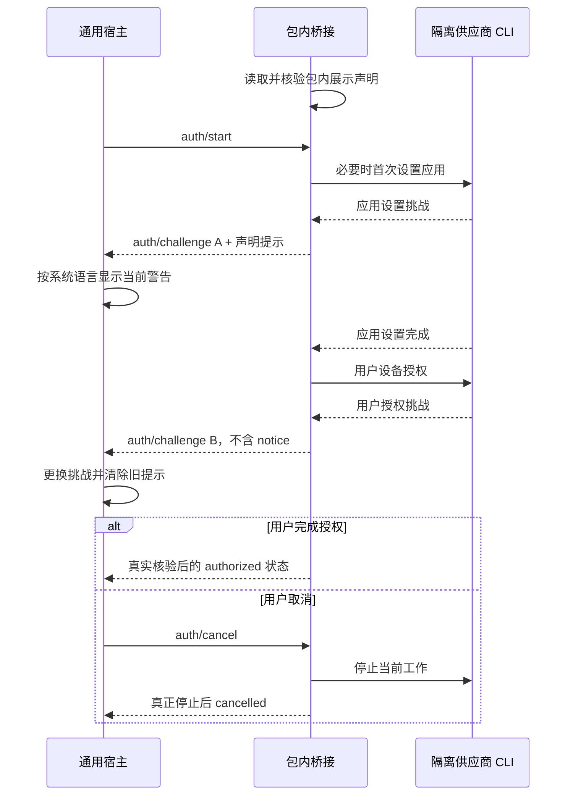

# 插件声明的授权挑战提示

[English](AUTH-CHALLENGE-NOTICES.md) | [简体中文](AUTH-CHALLENGE-NOTICES.zh-CN.md)

授权挑战可以带当前步骤的临时警告。提示文字由插件声明，插件桥接决定在哪个步骤发出；NeuxBot 通用处理验证、语言选择、展示及挑战生命周期。新增供应商不需要在宿主增加供应商文案或阶段判断。

在 `neuxally-auth/1` 的 `auth/challenge` 参数中增加可选 `notice`，无需升级消息协议：

```json
{
  "sessionId": "current-session",
  "challengeId": "current-challenge",
  "actions": [{ "type": "show-qr", "value": "实际供应商挑战" }],
  "notice": {
    "messages": {
      "en": "After the first scan completes application setup, scan again to authorize your account and permissions.",
      "zh-CN": "首次扫码完成应用设置后，还需再次扫码完成账号与权限授权。"
    }
  }
}
```

[消息提示 schema](../schemas/auth-challenge-notice.schema.json) 仅允许 `messages`，其中 `en` 和／或 `zh-CN` 为纯文本。至少有一种语言，拒绝其他语言或字段；每条最多 **2 KiB UTF-8 字节**，在 schema 字符上限外再做字节验证。不接受严重等级、HTML、动作、命令、凭据或供应商专属字段。宿主使用固定 warning 样式；没有 `notice` 就不展示警告。

提示只属于当前会话的这个 `challengeId`。更换挑战时完整替换提示，新挑战没有 notice 就清除旧提示；取消、到期、成功、失败和关闭弹窗时随挑战一起清理。不能将其复制到账号状态、安装记录、聊天记录或持久会话横幅。它不表示授权已完成，也不是新的可执行动作。

## 通用包内声明

任意插件可以在包内维护展示声明，并引用[通用包内展示 schema](../schemas/auth-presentation.schema.json)。`notices` 是插件自行命名的提示映射，不固定供应商或阶段；名称使用字母开头的 1–64 位字母、数字、下划线或连字符，最多 16 项。例如：

```json
{
  "schemaVersion": 1,
  "notices": {
    "additionalApproval": {
      "messages": {
        "en": "An additional approval step is required before this authorization can complete.",
        "zh-CN": "完成本次授权前，还需继续完成后续审批步骤。"
      }
    }
  }
}
```

包内同时维护两种语言。有界读取器拒绝符号链接、非普通文件、超过 16 KiB 的文件、非法 UTF-8／JSON、未知字段、不支持的 schema 版本、缺少翻译、控制字符及超过字节上限的文案。声明不提供动态 URL、shell 命令或执行配置。桥接读取声明文案，不在桥接或宿主硬编码文字。

## 飞书实例

飞书包使用 `.neuxally/auth/presentation.json`，将具体提示命名为 `initialSetup`；此名称只由飞书桥接选择，不属于通用协议字段。其他插件可声明任意符合规范的提示名称，并由自身桥接选择在哪个挑战发送。

仅首次 `config init` 创建／配置应用的挑战携带 `notices.initialSetup`。随后的 `auth login` 用户设备授权挑战使用新 ID，不携带 notice。已有应用配置时直接进入用户授权，不出现首次设置提示。任何阶段取消都须真正停止上游工作，不能继续发出下一阶段挑战或保留该阶段提示。



声明与读取器属于完整插件 ZIP，随固定来源快照核验，不是插件库的只读展示资料；details 侧车不包含可执行桥接配置。当前维护包和发布身份仍为 `0.1.0`，此可选展示字段不改变供应商程序及其资产锁。
